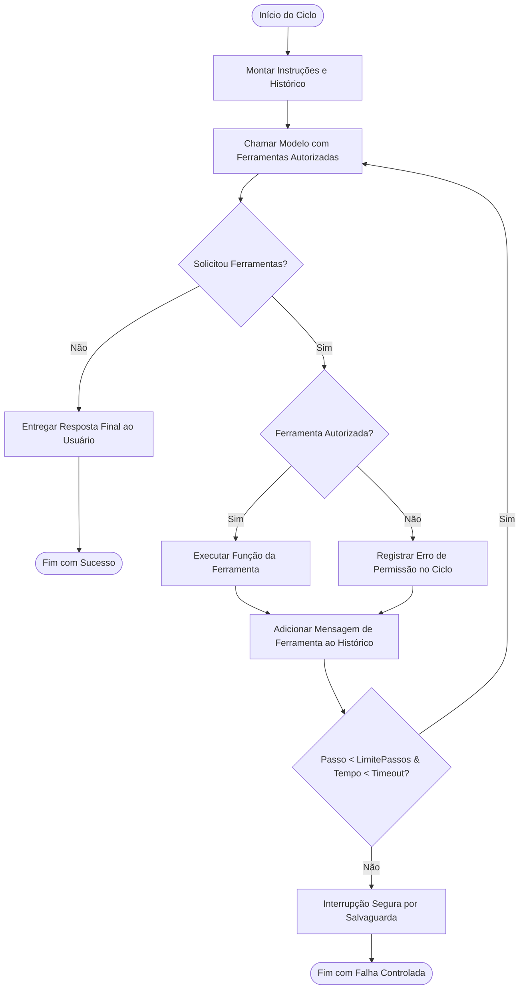

# Diretrizes Operacionais e Governança de Agentes (AGENTS.md)

Este documento define os princípios de arquitetura, padrões de projeto, ciclo cognitivo e regras de execução para agentes autônomos e assistentes que operam no ecossistema **Reusable AI Backend Architecture**.

---

## 1. Princípios Arquiteturais Obrigatórios

1. **Nomenclatura em Português Brasileiro**:
   - Todo código novo, variáveis, funções, classes, métodos próprios, parâmetros e nomes de módulos/arquivos devem adotar o português brasileiro culto e idiomático.
   - Apenas palavras-chave e símbolos nativos da linguagem Python (`def`, `class`, `yield`, `async`, `await`, etc.) e contratos externos imutáveis (`status_code`, `json`, etc.) permanecem em inglês.

2. **Clean Architecture e Arquitetura Hexagonal**:
   - **Domínio Puro**: O pacote `ai_core.dominio` não deve importar bibliotecas de transporte HTTP (`httpx`, `requests`), frameworks de web (`fastapi`, `starlette`) ou SDKs de terceiros.
   - **Portas e Adaptadores**: Qualquer comunicação externa ou persistência deve ocorrer através de contratos abstratos (`PortaProvedorLLM`, `PortaExecutorFerramentas`, `PortaRepositorioMemoria`, `PortaObservabilidade`).
   - **Inversão de Dependência**: A camada de aplicação e o gateway dependem de abstrações (portas), e os adaptadores concretos são injetados externamente.

3. **Segurança e Privilégio Mínimo**:
   - Nunca expor chaves de API em texto puro. Utilizar o `CofreCredenciais` com mascaramento (`CofreCredenciais.mascarar_chave(...)`).
   - Ferramentas que executam operações destrutivas ou com efeitos colaterais críticos devem declarar `requer_autorizacao=True` e ser avaliadas pela `PoliticaAutorizacaoFerramenta`.

---

## 2. Ciclo de Vida do Agente (Padrão ReAct)

O `OrquestradorAgente` opera segundo o loop cognitivo padronizado:



---

## 3. Salvaguardas e Confiabilidade

1. **Proteção Contra Loops Infinitos**:
   - Todo agente deve ter um `limite_passos` finito configurado (padrão máximo: 10 iterações).
   - Se o modelo insistir em invocar ferramentas sem atingir uma resposta final, o loop é interrompido com `sucesso=False` e erro descritivo.

2. **Timeouts Operacionais**:
   - Cada execução monitora o tempo decorrido via `time.monotonic()`. Ao ultrapassar `timeout_segundos`, a execução é abortada graciosamente.

3. **Resiliência e Fallback**:
   - Em caso de falha de conexão ou rate limit transitório, o `OrquestradorAgente` aproveita as camadas de `PoliticaRetentativa`, `Disjuntor` e `PoliticaFallback` configuradas no roteador de modelos.

---

## 4. Estrutura de Diretórios dos Agentes

```text
packages/ai-core/src/ai_core/
├── dominio/
│   └── modelos/
│       ├── agente.py           # ConfiguracaoAgente, PassoAgente, ResultadoExecucaoAgente
│       └── ferramenta.py       # DefinicaoFerramenta, ChamadaFerramenta, ResultadoFerramenta
└── aplicacao/
    └── agentes/
        └── orquestrador.py     # OrquestradorAgente (runtime do loop cognitivo)
```


---

## 5. Isolamento de Contexto e Multilocatário nos Agentes

1. **Separação Rígida por Sessão / Usuário**:
   - Todo contexto conversacional associado à execução de agentes deve respeitar a chave de partição `id_conversa` e a posse `id_usuario`.
   - O orquestrador nunca deve mesclar ferramentas ou memórias pertencentes a usuários distintos.
2. **Quota e Limitação Orçamentária**:
   - O consumo acumulado de tokens em chamadas de raciocínio ReAct é submetido à `PoliticaOrcamentoTokens`, prevenindo esgotamento de recursos decorrente de loops de ferramentas.
