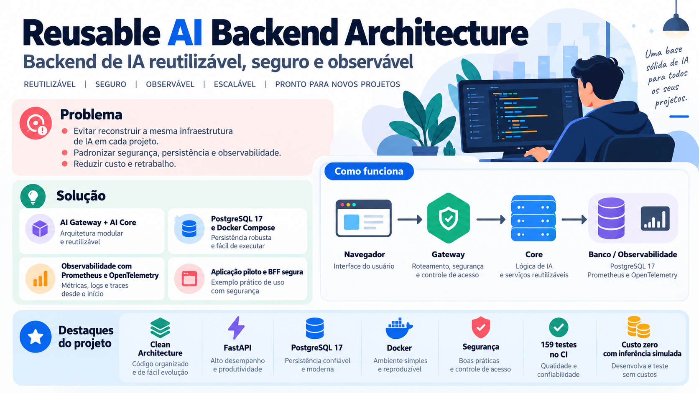
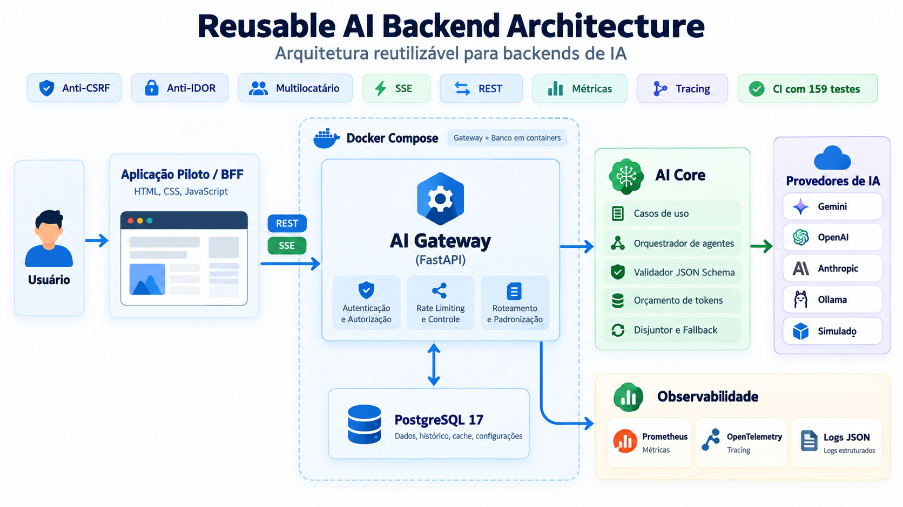

# Reusable AI Backend Architecture

Enterprise, decoupled, and reusable backend platform for modern Artificial Intelligence applications, autonomous agent orchestration, and high-reliability inference gateways.

> 🇧🇷 **Versão em Português**: A versão principal desta documentação em português brasileiro está disponível em [README.md](README.md).

<p align="center">
  
</p>

<p align="center">
  <a href="https://www.python.org/"></a>
  <a href="https://fastapi.tiangolo.com/"></a>
  <a href="https://www.postgresql.org/"></a>
  <a href="https://www.docker.com/"></a>
  <a href="https://docs.pytest.org/"></a>
  <a href="https://github.com/astral-sh/ruff"></a>
  <a href="https://pypi.org/project/pip-audit/"></a>
</p>

---

## 1. Overview: Problem and Solution

When engineering teams incorporate Generative Artificial Intelligence into digital products, attention often converges on model selection and prompt design. However, in enterprise production environments, the most critical failures rarely stem from model inference quality; they arise from the **lack of defensive software engineering in the backend**.

### The Problem
AI systems built without a robust architectural foundation face severe operational risks:
- **Proprietary SDK Lock-in**: Application code tightly coupled to vendor-specific libraries, preventing seamless migrations or multi-model fallback strategies.
- **Uncontrolled Token Budget Spills (TOCTOU Race Conditions)**: Balance validation performed after the fact (*post-billing*), allowing concurrent asynchronous requests to exceed tenant quotas.
- **Cascading Failures and Downtime**: Absence of circuit breakers and exponential retries, causing transient external API hiccups to bring down edge services.
- **Critical Edge Vulnerabilities**: Exposing master API keys in client browsers, cross-site request forgery (CSRF), script injection (DOM XSS), and insecure direct object references (IDOR) on conversation history.

### The Solution
The **Reusable AI Backend Architecture** addresses these challenges through a reference **Modular Monolith** built on the principles of **Clean Architecture**, **Hexagonal Architecture (Ports and Adapters)**, and **SOLID**:
- **Total Decoupling**: The core domain (`AI Core`) is a pure Python library, completely free of HTTP transport frameworks and external cloud SDK dependencies.
- **Two-Phase Atomic Token Reservation**: The estimated budget is reserved before dispatching the inference request and reconciled with actual token consumption upon completion, mitigating intraprocess TOCTOU race conditions.
- **Resilience and Fault Tolerance**: Integrated circuit breaker, exponential backoff with stochastic jitter, and transparent fallback across configured models.
- **Reliable Persistence with Anti-IDOR**: Durable conversation history in **PostgreSQL 17**, enforced by relational ownership verification per user.
- **Continuous Observability**: Standardized, low-cardinality Prometheus metrics and W3C TraceContext-compliant OpenTelemetry distributed tracing.
- **Zero Financial Cost for Development**: Operable and testable with 100% test pass rate using the built-in `AdaptadorSimulado` (Mock) or local inference with `Ollama`.

---

## 2. Implemented Features

All capabilities listed below are **fully implemented in code, containerized, and verified by automated tests**:

- [x] **Decoupled Modular Monolith**: Strict architectural separation between the pure AI domain (`packages/ai-core`) and the HTTP edge service (`services/ai-gateway`).
- [x] **AI Inference Use Cases**:
  - Synchronous inference tracking latency and token usage.
  - Asynchronous streaming via **Server-Sent Events (SSE)** with `BaseException` (`asyncio.CancelledError`) handling for safe budget release on client disconnects.
  - Structured output with strict **JSON Schema** validation, local `$defs`/`$ref` resolution, and syntactic Markdown fence auto-repair.
- [x] **Autonomous ReAct Agent Runtime**:
  - Standardized cognitive loop (*Thought &rarr; Action &rarr; Observation*).
  - Strict safeguards: finite step limit (default ceiling of 10 iterations), global execution timeouts, and pre-authorized tool execution policies.
- [x] **Domain Resilience Suite**:
  - **Circuit Breaker**: *Closed*, *Open*, and *Half-Open* states with automatic recovery windows and configurable error thresholds.
  - **Smart Retries**: Exponential backoff with stochastic *jitter* to mitigate thundering herd load spikes.
  - **Model Router with Fallback**: Automatic failover to secondary models upon transient provider errors.
- [x] **Budget Governance & Token Reservation**:
  - Two-phase protocol (pre-reserve and reconcile) guarded by intraprocess asynchronous locks (`asyncio.Lock`).
- [x] **Secure Relational Persistence**:
  - Asynchronous **PostgreSQL 17** adapter with high-throughput `asyncpg` connection pooling and versioned idempotent migrations (`schema_migracoes`).
  - Lightweight **SQLite** adapter running in WAL (*Write-Ahead Logging*) mode for local concurrency.
  - **Relational Anti-IDOR Enforcement**: Mandatory ownership check (`id_usuario`) before any read or write access to conversations.
- [x] **Edge Security & BFF Layer**:
  - Defensive HTTP middlewares: security headers injection (`Strict HSTS`, `X-Content-Type-Options: nosniff`, `X-Frame-Options: DENY`, `Referrer-Policy: strict-origin-when-cross-origin`, and `Permissions-Policy`).
  - **Anti-Spoofing Identity Guard**: Stripping and strict auditing of untrusted `X-User-ID` headers from direct external clients.
  - **Backend-For-Frontend (BFF)**: Session cookies authenticated via symmetric HMAC-SHA256 (`piloto_sessao`) and constant-time anti-CSRF token verification (`hmac.compare_digest`).
- [x] **Telemetry & Observabilidade**:
  - Prometheus collector exposing operational and security metrics at `/metrics`.
  - OpenTelemetry distributed spans adhering to the W3C TraceContext standard.
- [x] **Interactive Reference Pilot Application**:
  - Lightweight HTML5/Vanilla JS SPA served at `/piloto`, externalized to `/piloto/app.js` for strict Content Security Policy compliance (zero `'unsafe-inline'`).

---

## 3. Architecture Diagram

<p align="center">
  
</p>

> ℹ️ **Engineering Note**: The diagram above illustrates conceptual building blocks, traffic flows, and isolation boundaries. For detailed C4 models (Level 1: System Context, Level 2: Containers) and technical sequence flowcharts, see the [Architecture Documentation](docs/arquitetura.md).

---

## 4. Component Breakdown

### 4.1 `AI Core` (`packages/ai-core`)
The heart of the application, designed as a pure Python domain library. Adhering to **Clean Architecture**, the `ai_core.dominio` package contains zero imports from web frameworks (`fastapi`, `starlette`) or HTTP transport libraries (`httpx`, `requests`).
- **Abstract Contracts (*Ports*)**: `PortaProvedorLLM`, `PortaRepositorioMemoria`, `PortaExecutorFerramentas`, `PortaObservabilidade`.
- **Use Cases**: Encapsulate business logic for synchronous inference, streaming SSE, and structured schema validation.
- **Agent Runtime**: Coordinates ReAct loops while isolating tool access and memory by session and user.

### 4.2 `AI Gateway` (`services/ai-gateway`)
The HTTP edge service acts as the system entry point, implemented on **FastAPI** and served by the **Uvicorn** ASGI engine:
- **Canonical Endpoints**: `/health`, `/metrics`, `/v1/modelos`, `/v1/chat/conclusoes`, `/v1/chat/estruturado`, `/v1/agentes/executar`, and `/v1/conversas/{id_conversa}`.
- **Edge Defenses**: Input header sanitization, identity spoofing prevention, and rate limiting enforcement.
- **BFF Intermediate Layer**: Dedicated router (`/piloto/api`) managing browser authentication via `HttpOnly` HMAC-SHA256 cookies and CSRF validation.

### 4.3 LLM Provider Adapters
Communication with language models is handled exclusively through adapters satisfying the `PortaProvedorLLM` contract:
- **`AdaptadorSimulado`**: Emulates deterministic responses and token consumption, enabling development, testing, and CI with zero cloud costs.
- **`AdaptadorOllama`**: Enables local inference with open weights models (e.g., Llama, Mistral) without sending data to third parties.
- **Commercial Cloud Adapters (`OpenAI`, `Google Gemini`, `Anthropic`, `DeepSeek`)**: Fully structured and verified in unit tests via `MockTransport` (HTTPX). Live production integration requires operator-supplied API credentials in `.env`.

### 4.4 Relational Persistence: PostgreSQL 17
Conversation history and session state are durably maintained in **PostgreSQL 17 Alpine**:
- Managed via an asynchronous connection pool (`asyncpg`).
- Schema migrations applied idempotently and tracked in the `schema_migracoes` ledger.
- **Anti-IDOR Security**: Every read or write query strictly enforces relational ownership: `WHERE id_conversa = $1 AND id_usuario = $2`.

### 4.5 Observability & Telemetry
- **Prometheus (`/metrics`)**: Low-cardinality operational metrics, error rates, millisecond latency histograms, token usage counters, and blocked IDOR attempts.
- **OpenTelemetry**: Distributed tracing emitting standardized spans with W3C `traceparent` and `X-Request-ID` propagation.
- **Privacy by Design**: Explicit scrubbing of Personally Identifiable Information (PII) from telemetry attributes.

### 4.6 Containerized Infrastructure (Docker Compose)
Local and production runtime orchestrated via `docker-compose.yml`:
- Minimal, immutable multi-stage Docker image based on Python 3.13 slim.
- Strict execution under an unprivileged user (`appuser`, UID/GID 10001).
- Persistent external named volumes (`dados_postgresql`).
- Integrated healthchecks periodically monitoring node health.

### 4.7 Reference Pilot Application
Accessible at `http://localhost:8000/piloto`, this reference single-page application is built on standard web technologies (HTML5, CSS3, Vanilla JS):
- Zero complex build pipelines or Node.js/npm dependencies.
- Visually showcases AI chat, real-time latency and token metrics, persistent relational storage, and multi-tenant user switching (`usuario_alfa` and `usuario_beta`) to prove Anti-IDOR enforcement.

---

## 5. Security & Technical Limitations

In the interest of senior engineering transparency, the following operational boundaries and assumptions apply to the current implementation:

1. **Intraprocess Scope of Token Budgeting**:
   - The `PoliticaOrcamentoTokens` and `LimitadorTaxa` utilize in-memory asynchronous locks (`asyncio.Lock()`).
   - Concurrency guarantees and TOCTOU mitigations operate strictly within the local application process. In horizontally scaled deployments (multiple Uvicorn workers or container replicas), enforcing a unified quota across processes requires an external distributed coordinator (such as Redis with transactional Lua scripts).
2. **TLS Termination & Reverse Proxies**:
   - In accordance with RFC 6797 Section 7.2 (*HSTS Spoofing*), the Gateway inspects `request.url.scheme == "https"`, refusing to blindly trust `X-Forwarded-Proto` headers from direct clients.
   - In production deployments behind cloud load balancers or reverse proxies (Cloudflare, AWS ALB, Nginx), Uvicorn must be explicitly configured with `--proxy-headers` and `--forwarded-allow-ips`.
3. **Testing & Security Audit Scope**:
   - The repository features 159 deterministic tests, real PostgreSQL database integration, and structural static auditing guided by the Cloudflare Security Audit Skill.
   - While this evidence verifies strict adherence to defensive engineering practices, it does not constitute formal compliance certification (such as ISO 27001 or SOC 2), nor does it replace dynamic application security testing (DAST penetration testing) or stress testing in dedicated staging environments.

---

## 6. Technology Stack

| Category | Technology | Architectural Rationale |
| :--- | :--- | :--- |
| **Language** | Python 3.13 | High-performance native async I/O, strict typing, and mature ecosystem. |
| **API Framework** | FastAPI 0.115+ | High ASGI throughput, declarative Pydantic v2 validation, and native SSE streaming. |
| **Database** | PostgreSQL 17 Alpine | ACID relational persistence, enterprise reliability, and async `asyncpg` driver. |
| **Local Database** | SQLite (WAL Mode) | Fast, lightweight persistence for CLI tools and isolated test runs. |
| **Containers** | Docker & Docker Compose | Immutable environments, non-root execution, and exact parity between dev and prod. |
| **Metrics** | Prometheus Client | Standardized metric exposition at `/metrics` with controlled cardinality. |
| **Tracing** | OpenTelemetry | Distributed spans instrumented with W3C TraceContext propagation. |
| **Quality & Lint** | Ruff | Blazing fast linter and formatter enforcing strict style rules. |
| **SCA Security** | pip-audit | Automated dependency scanning for known vulnerabilities (CVEs). |
| **Package Manager**| Astral `uv` | Deterministic resolution and ultra-fast monorepo workspace synchronization. |

---

## 7. Local Quickstart

### Option A: Containerized via Docker Compose (Recommended)

1. **Copy the environment configuration template**:
   ```bash
   cp .env.example .env
   ```
2. **Start the core services (AI Gateway + PostgreSQL 17)**:
   ```bash
   docker compose up -d
   ```
3. **Verify service health status**:
   ```bash
   docker compose ps
   ```
   *Both containers (`ia-gateway` and `ia-postgres`) should show a `healthy` status.*
4. **Validate canonical endpoints**:
   ```bash
   # Gateway liveness check
   curl http://localhost:8000/health

   # Prometheus metrics scrape
   curl http://localhost:8000/metrics
   ```
5. **Access the pilot web interface**:
   Open your browser at [http://localhost:8000/piloto](http://localhost:8000/piloto).
6. **Stop services while preserving data volumes**:
   ```bash
   docker compose down
   ```

---

### Option B: Bare-Metal Execution with `uv`

1. **Synchronize monorepo workspace dependencies**:
   ```bash
   uv sync --all-packages
   ```
2. **Run the automated test suite**:
   ```bash
   uv run pytest -v
   ```
3. **Execute linter and code formatting checks**:
   ```bash
   uv run ruff check .
   uv run ruff format --check .
   ```
4. **Run software composition analysis (SCA)**:
   ```bash
   uv run --with pip-audit pip-audit
   ```
5. **Start the development server**:
   ```bash
   uv run uvicorn ai_gateway.main:app --host 0.0.0.0 --port 8000 --reload
   ```

---

## 8. Quality Assurance, Testing & CI

System reliability is enforced by a deterministic **GitHub Actions** CI pipeline:

- **159 Automated Tests**:
  - **155 unit and local integration tests** running in network isolation with mocks and SQLite.
  - **4 physical integration tests** running against a live **PostgreSQL 17** service container on GitHub Actions.
  - **100% Test Pass Rate**: All 159 test scenarios pass consistently (*155 passed, 4 skipped in DB-less local environments; 159 passed in CI with active PostgreSQL*).
  - *Metrological Distinction*: This metric verifies functional correctness across all specified test scenarios; it must not be confused with full statement/branch code coverage via `pytest-cov`.
- **Static Code Analysis**: Zero violations in `ruff check` and `ruff format`.
- **Software Supply Chain Security (SCA)**: Zero known vulnerabilities detected via `pip-audit`.

---

## 9. Technical Documentation & The Seven Pillars Handbook

Explore the in-depth documentation suite in the [`docs/`](docs/) directory:

- 📐 [Architecture Documentation & C4 Models](docs/arquitetura.md): System context, containers, and component topology.
- 🐳 [Infrastructure & Docker Guide](docs/infraestrutura.md): Container parameters, non-root security, and volume mappings.
- 🛡️ [Security & AppSec Guide](docs/seguranca.md): Edge defenses, threat analysis, and remediations SEC-001 through SEC-009 and REV-001 through REV-003.
- 📡 [API Contracts & REST/SSE Routes](docs/contratos_api.md): Payload schemas, headers, and error specifications.
- 🧪 [Automated Testing Strategy](docs/estrategia_testes.md): Testing pyramid, mocking, and real-database validation.
- 🖥️ [Pilot Application & BFF Guide](docs/aplicacao_piloto.md): Web client architecture, HMAC session flow, and CSRF protection.
- 📊 [Observability & Telemetry](docs/observabilidade.md): Prometheus metric standards and OpenTelemetry W3C spans.
- 📚 [The Seven Pillars Technical Handbook](docs/caderno_tecnico.md): Comprehensive treatise covering Fundamental Concepts, Progressive Explanations, Real Application, Trade-offs, Hands-on Exercises, and Review Questions.
- 📜 [Architecture Decision Records (ADRs 0001 to 0011)](docs/adr/): Immutable historical record of architectural decisions and trade-offs.

---

## 10. AI-Assisted Development Transparency

This project was built on the frontier of **Artificial Intelligence-Assisted Software Engineering**:

- **Human Leadership & Architecture (Airton Neto)**: Business requirement definition, Clean Architecture design, governance and naming enforcement (`AGENTS.md`), rigorous code reviews, subtle concurrency bug identification, and final merge decisions.
- **Autonomous AI Agents (Antigravity)**: Code scaffolding, concrete adapter implementation, automated test authoring, and static security audit assistance.

For a detailed case study on human-AI governance and collaboration in software engineering, refer to **Pillar 7** of the [Technical Handbook](docs/caderno_tecnico.md).

---

## 11. Relevant Links

- **Repository**: [AirtonNettu/reusable-ai-backend-architecture](https://github.com/AirtonNettu/reusable-ai-backend-architecture)
- **Pull Requests & Engineering History**: [GitHub Pull Requests](https://github.com/AirtonNettu/reusable-ai-backend-architecture/pulls)
- **Continuous Integration Pipeline**: [GitHub Actions Workflow Runs](https://github.com/AirtonNettu/reusable-ai-backend-architecture/actions)
- **Primary Architecture Document**: [docs/arquitetura.md](docs/arquitetura.md)
- **The Seven Pillars Technical Handbook**: [docs/caderno_tecnico.md](docs/caderno_tecnico.md)
