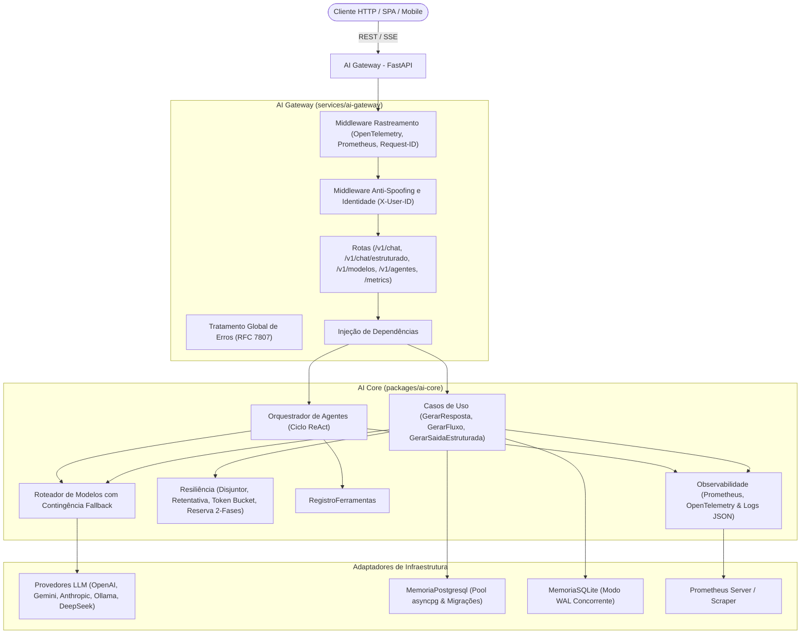

# Reusable AI Backend Architecture

Plataforma corporativa desacoplada e reutilizável para aplicações de Inteligência Artificial moderna, orquestração de agentes e gateways HTTP de alto desempenho.

---

## 🇧🇷 Português

### 1. Visão Geral

O **Reusable AI Backend Architecture** não é um mero *wrapper* de chamadas HTTP. É uma arquitetura de nível corporativo projetada segundo os princípios de **Clean Architecture**, **Arquitetura Hexagonal (Portas e Adaptadores)**, **SOLID** e **Monólito Modular**, composta por dois módulos principais:

1. **`AI Core`** (`packages/ai-core`):
   - Núcleo de domínio e biblioteca Python independente de HTTP, transportes ou SDKs externos.
   - Contratos agnósticos para LLMs (`PortaProvedorLLM`), ferramentas (`PortaExecutorFerramentas`), memória (`PortaRepositorioMemoria`) e observabilidade (`PortaObservabilidade`).
   - Adaptadores concretos para **Ollama**, **Google Gemini**, **OpenAI**, **DeepSeek**, **Anthropic** e **Simulado (Fake/Mock)**.
   - Persistência conversacional assíncrona em **PostgreSQL** (com pool de conexões e migrações versionadas), **SQLite (modo WAL)** e volátil em memória, com **isolamento multilocatário por usuário** e proteção contra IDOR.
   - Validador seguro de **JSON Schema** com suporte a referências locais (`$defs`, `$ref`), `enum`, limites numéricos e de strings.
   - Políticas completas de confiabilidade: **Disjuntor (Circuit Breaker)**, **Retentativas com Backoff Exponencial e Jitter**, **Limitador de Taxa (Token Bucket)**, **Semáforo de Concorrência**, **Protocolo de Reserva de Tokens em Duas Fases** (prevenção contra race condition TOCTOU e cancelamento em falhas) e **Fallback Controlado**.
   - Runtime e orquestração de **Agentes Autônomos (Padrão ReAct)** com salvaguardas contra loops infinitos e controle rigoroso de permissões de ferramentas.
   - Camada de **Observabilidade e Métricas**: instrumentação nativa Prometheus (`MetricasPrometheus`), rastreamento distribuído OpenTelemetry (`GerenciadorRastreamento`) com W3C `traceparent` e logs estruturados em JSON com mascaramento automático de credenciais (`FormatadorLogJson`).

2. **`AI Gateway`** (`services/ai-gateway`):
   - Serviço HTTP/REST/SSE desenvolvido sobre **FastAPI**.
   - Endpoints com validação Pydantic e defesas contra DoS: `/health`, `/metrics` (Prometheus), `/v1/modelos`, `/v1/chat/conclusoes` (com streaming SSE), `/v1/chat/estruturado` (JSON Schema rigoroso com autorreparo) e `/v1/agentes/executar`.
   - Middlewares globais para rastreamento (`X-Request-ID`, `X-Process-Time`, `traceparent`) e mapeamento de exceções de domínio para respostas padronizadas (RFC 7807).
   - Autenticação e identificação multilocatário com **Proteção Anti-Spoofing** via `X-API-Key`, `Authorization: Bearer` e `X-User-ID` auditado.
   - Ciclo de vida assíncrono com aplicação automática e idempotente de migrações do PostgreSQL no startup.

---

### 2. Arquitetura



---

### 3. Execução Rápida

#### Opção A: Infraestrutura Local Completa com Docker Compose (Recomendada)

```bash
# 1. Copiar o arquivo de exemplo de ambiente
cp .env.example .env

# 2. Iniciar o stack básico (AI Gateway + PostgreSQL 17) em segundo plano
docker compose up -d

# 3. Verificar o status e healthchecks dos serviços
docker compose ps

# 4. Acessar endpoint de métricas Prometheus
curl http://localhost:8000/metrics

# 5. Encerrar os serviços preservando os volumes de dados
docker compose down
```

Para mais detalhes sobre volumes, variáveis e portas, consulte o [Guia de Infraestrutura](file:///C:/Users/Airton/reusable-ai-backend-architecture/docs/infraestrutura.md) e o [Guia de Observabilidade](file:///C:/Users/Airton/reusable-ai-backend-architecture/docs/observabilidade.md).

#### Opção B: Desenvolvimento Nativo com uv

```bash
# 1. Sincronizar workspace e dependências
uv sync --all-packages

# 2. Executar suíte completa de testes automatizados (109 cenários)
uv run pytest -v

# 3. Executar verificações de linter e formatação estrita
uv run ruff check .
uv run ruff format --check .

# 4. Iniciar o AI Gateway em desenvolvimento
uv run uvicorn ai_gateway.main:app --host 0.0.0.0 --port 8000 --reload
```

---

### 4. Observabilidade e Monitoramento

A plataforma disponibiliza três pilares integrados de telemetria corporativa:
1. **Métricas Prometheus (`GET /metrics`)**: Contadores de requisições, histogramas de latência HTTP e inferência LLM, tokens faturados (entrada/saída), transições de circuitos de resiliência (`disjuntor_estado`), passos cognitivos de agentes e latências de banco. Protegido opcionalmente por `METRICAS_TOKEN`.
2. **OpenTelemetry Distribuído**: Rastreamento com geração de spans em requisições, casos de uso e agentes, injeção do cabeçalho oficial W3C `traceparent` e sanitização estrita contra vazamento de prompts ou chaves.
3. **Logs Estruturados JSON**: Ingestão corporativa com `FormatadorLogJson`, correlacionando `trace_id`, `span_id` e `request_id` em tempo real com mascaramento automático de credenciais.

Para detalhes completos e exemplos de integração com Prometheus e Grafana, consulte [docs/observabilidade.md](file:///C:/Users/Airton/reusable-ai-backend-architecture/docs/observabilidade.md) e a [ADR 0009](file:///C:/Users/Airton/reusable-ai-backend-architecture/docs/adr/0009-observabilidade-prometheus-opentelemetry-e-rastreamento-distribuido.md).

---


---

### 5. Aplicação Piloto e Interface de Referência (BFF)

A arquitetura inclui uma aplicação piloto interativa e responsiva servida diretamente pelo AI Gateway em:
`	ext
http://localhost:8000/piloto
`

Principais recursos demonstrados:
- **Zero Frameworks Pesados**: Implementada em HTML5, CSS3 moderno e Vanilla JavaScript (SPA nativa, sem Node.js/npm).
- **Camada Intermediária Segura (BFF)**: O navegador nunca recebe ou manipula chaves mestras (GATEWAY_API_KEY) ou strings de conexão SQL.
- **Persistência Relacional**: Diálogo mantido e recuperado do **PostgreSQL 17**, resistindo a reinicializações.
- **Multilocatário e Anti-IDOR**: Alternador de perfis (usuario_alfa e usuario_beta) que comprova o bloqueio relacional com 403 Forbidden.
- **Telemetria Visível**: Exibição em tempo real do X-Request-ID, tempo de latência, contagem de tokens e atalho para /metrics.

Para instruções completas e cenários de teste, consulte o [docs/aplicacao_piloto.md](docs/aplicacao_piloto.md) e a [ADR 0010](docs/adr/0010-aplicacao-piloto-e-interface-bff-segura.md).

## 🇺🇸 English

### 1. Overview

**Reusable AI Backend Architecture** is a production-grade, enterprise backend platform for Artificial Intelligence applications. Designed around **Clean Architecture**, **Hexagonal Architecture (Ports and Adapters)**, **SOLID**, and **Modular Monolith** principles, it consists of two distinct components:

1. **`AI Core`** (`packages/ai-core`):
   - Transport-agnostic Python domain library decoupled from HTTP frameworks and provider SDKs.
   - Pure domain abstractions for LLM providers (`PortaProvedorLLM`), tool execution (`PortaExecutorFerramentas`), conversational memory (`PortaRepositorioMemoria`), and observability (`PortaObservabilidade`).
   - Production adapters for **Ollama**, **Google Gemini**, **OpenAI**, **DeepSeek**, **Anthropic**, and **Mock/Simulated**.
   - Asynchronous **PostgreSQL memory (with connection pool & versioned migrations)**, **SQLite (WAL mode)**, and in-memory storage, featuring **multi-tenant user isolation** and IDOR protection.
   - Resilient **JSON Schema validator** supporting `$defs`, `$ref`, `enum`, min/max constraints, and safe metadata keywords.
   - Full resilience suite: **Circuit Breaker**, **Exponential Backoff Retries with Jitter**, **Token Bucket Rate Limiter**, **Concurrency Semaphore**, **Two-Phase Token Reservation Protocol** (preventing TOCTOU race conditions and cancellation rollbacks), and **Configured Fallback Routing**.
   - **Autonomous Agent Runtime (ReAct pattern)** with loop protection and permission-based tool security.
   - **Observability Layer**: Native Prometheus metrics (`MetricasPrometheus`), OpenTelemetry distributed tracing (`GerenciadorRastreamento`) with W3C `traceparent`, and structured JSON logging with automated credential redaction (`FormatadorLogJson`).

2. **`AI Gateway`** (`services/ai-gateway`):
   - Fast and reliable HTTP/REST/SSE service built with **FastAPI**.
   - Endpoints: `/health`, `/metrics` (Prometheus), `/v1/modelos` (catalog), `/v1/chat/conclusoes` (synchronous & SSE streaming), `/v1/chat/estruturado` (JSON Schema with auto-repair), and `/v1/agentes/executar`.
   - Global tracking middleware (`X-Request-ID`, `X-Process-Time`, `traceparent`) and RFC 7807 problem detail handlers.
   - Multi-tenant authentication with **Anti-Spoofing Security** (`X-API-Key`, `Authorization: Bearer`, audited `X-User-ID`).
   - Asynchronous lifecycle management with automated idempotent PostgreSQL migrations on startup.

### 2. Infrastructure & Local Orchestration

The platform provides a production-hardened local environment orchestrated with **Docker Compose**:
- **Multi-Stage Dockerfile**: Fast builds using `uv`, producing minimal runtime images based on `python:3.13-slim` running under non-root user `appuser` (UID `10001`).
- **PostgreSQL 17 Alpine**: Isolated database service with persistent volume (`ia_dados_postgresql`), healthchecks, and internal bridge network (`ia_rede_interna`).
- **Ollama**: Optional local model inference service activated via profile (`--profile ollama`).
- **Observability Endpoint**: Ready for Prometheus scraping on `/metrics` with low-cardinality label guarantees and optional bearer token protection.

```bash
# 1. Prepare environment file
cp .env.example .env

# 2. Run core stack (AI Gateway + PostgreSQL 17)
docker compose up -d

# 3. Check health and services status
docker compose ps

# 4. Scrape metrics
curl http://localhost:8000/metrics

# 5. Tear down services (preserving volumes)
docker compose down
```

For complete technical specifications, see [docs/infraestrutura.md](file:///C:/Users/Airton/reusable-ai-backend-architecture/docs/infraestrutura.md), [docs/observabilidade.md](file:///C:/Users/Airton/reusable-ai-backend-architecture/docs/observabilidade.md), [ADR 0008](file:///C:/Users/Airton/reusable-ai-backend-architecture/docs/adr/0008-conteinerizacao-docker-compose-e-orquestracao-local.md), and [ADR 0009](file:///C:/Users/Airton/reusable-ai-backend-architecture/docs/adr/0009-observabilidade-prometheus-opentelemetry-e-rastreamento-distribuido.md).

---

### 3. Pilot Application & Reference UI (BFF)

An interactive, responsive pilot application is served directly by the AI Gateway at:
`	ext
http://localhost:8000/piloto
`

Key features demonstrated:
- **Lightweight Architecture**: Single Page Application built with HTML5, modern CSS, and Vanilla JavaScript with zero Node/npm overhead.
- **Secure Backend-For-Frontend (BFF)**: Browser never receives master API keys or database connection strings.
- **Relational Memory**: Chat continuity backed by **PostgreSQL 17**, surviving service restarts.
- **Multi-Tenant IDOR Prevention**: Switch between usuario_alfa and usuario_beta to verify tenant isolation and access controls.
- **Diagnostic Telemetry**: Displays X-Request-ID, latency (ms), token usage, and quick links to /metrics.

For full documentation, see [docs/aplicacao_piloto.md](docs/aplicacao_piloto.md) and [ADR 0010](docs/adr/0010-aplicacao-piloto-e-interface-bff-segura.md).

