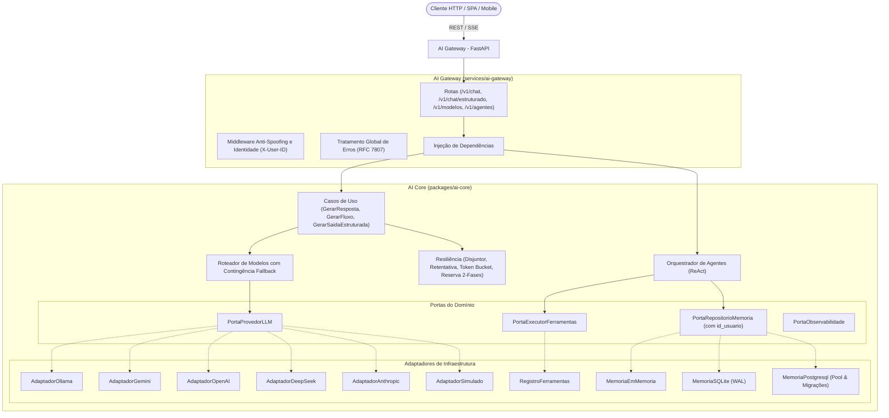

# Reusable AI Backend Architecture

Plataforma corporativa desacoplada e reutilizável para aplicações de Inteligência Artificial moderna, orquestração de agentes e gateways HTTP de alto desempenho.

---

## 🇧🇷 Português

### 1. Visão Geral

O **Reusable AI Backend Architecture** não é um mero *wrapper* de chamadas HTTP. É uma arquitetura de nível corporativo projetada segundo os princípios de **Clean Architecture**, **Arquitetura Hexagonal (Portas e Adaptadores)**, **SOLID** e **Monólito Modular**, composta por dois módulos principais:

1. **`AI Core`** (`packages/ai-core`):
   - Núcleo de domínio e biblioteca Python independente de HTTP, transportes ou SDKs externos.
   - Contratos agnósticos para LLMs (`PortaProvedorLLM`), ferramentas (`PortaExecutorFerramentas`), memória (`PortaRepositorioMemoria`) e observabilidade (`PortaObservabilidade`).
   - Adaptadores concretos para **Ollama**, **Google Gemini**, **OpenAI**, **DeepSeek**, **Anthropic** e **Simulado (Fake/Mock)**.
   - Persistência conversacional assíncrona em **PostgreSQL** (com pool de conexões e migrações versionadas), **SQLite (modo WAL)** e volátil em memória, com **isolamento multilocatário por usuário** e proteção contra IDOR.
   - Validador seguro de **JSON Schema** com suporte a referências locais (`$defs`, `$ref`), `enum`, limites numéricos e de strings.
   - Políticas completas de confiabilidade: **Disjuntor (Circuit Breaker)**, **Retentativas com Backoff Exponencial e Jitter**, **Limitador de Taxa (Token Bucket)**, **Semáforo de Concorrência**, **Protocolo de Reserva de Tokens em Duas Fases** (prevenção contra race condition TOCTOU e cancelamento em falhas) e **Fallback Controlado**.
   - Runtime e orquestração de **Agentes Autônomos (Padrão ReAct)** com salvaguardas contra loops infinitos e controle rigoroso de permissões de ferramentas.

2. **`AI Gateway`** (`services/ai-gateway`):
   - Serviço HTTP/REST/SSE desenvolvido sobre **FastAPI**.
   - Endpoints com validação Pydantic e defesas contra DoS: `/health`, `/v1/modelos`, `/v1/chat/conclusoes` (com streaming SSE), `/v1/chat/estruturado` (JSON Schema rigoroso com autorreparo) e `/v1/agentes/executar`.
   - Middlewares globais para rastreamento (`X-Request-ID`, `X-Process-Time`) e mapeamento de exceções de domínio para respostas padronizadas (RFC 7807).
   - Autenticação e identificação multilocatário com **Proteção Anti-Spoofing** via `X-API-Key`, `Authorization: Bearer` e `X-User-ID` auditado.
   - Ciclo de vida assíncrono com aplicação automática e idempotente de migrações do PostgreSQL no startup.

---

### 2. Arquitetura



---

### 3. Stack Tecnológico e Infraestrutura

- **Python**: 3.13
- **FastAPI**: 0.159+
- **Pydantic**: 2.14+
- **HTTPX**: 0.28+
- **asyncpg**: 0.32+
- **PostgreSQL**: 17 (imagem oficial `postgres:17-alpine`)
- **Docker & Docker Compose**: Multi-stage build com usuário não-root (`appuser`), redes isoladas e perfis opcionais (Ollama)
- **uv**: Gerenciador de workspaces e pacotes
- **pytest & pytest-asyncio**: Suíte automatizada de testes (94 cenários: 90 unitários/simulados/infraestrutura e 4 de integração física com PostgreSQL 17 real)
- **Ruff**: Linter e formatador de código estático

---

### 4. Instalação e Execução

#### Opção A: Execução Local via Docker Compose (Recomendado)

```bash
# 1. Configurar variáveis de ambiente a partir do exemplo documentado
cp .env.example .env

# 2. Inicializar o AI Gateway e o PostgreSQL 17 em segundo plano
docker compose up -d

# 3. Inicializar incluindo o servidor opcional de inferência local Ollama
docker compose --profile ollama up -d

# 4. Verificar o estado dos contêineres e healthchecks
docker compose ps

# 5. Acompanhar os logs do AI Gateway em tempo real
docker compose logs -f ai-gateway

# 6. Encerrar os serviços preservando os volumes de dados
docker compose down
```

Para mais detalhes sobre volumes, variáveis e portas, consulte o [Guia de Infraestrutura](file:///C:/Users/Airton/reusable-ai-backend-architecture/docs/infraestrutura.md).

#### Opção B: Desenvolvimento Nativo com uv

```bash
# 1. Sincronizar workspace e dependências
uv sync --all-packages

# 2. Executar suíte completa de testes automatizados
uv run pytest -v

# 3. Executar verificações de linter e formatação estrita
uv run ruff check .
uv run ruff format --check .

# 4. Iniciar o AI Gateway em desenvolvimento
uv run uvicorn ai_gateway.main:app --host 0.0.0.0 --port 8000 --reload
```

---

## 🇺🇸 English

### 1. Overview

**Reusable AI Backend Architecture** is a production-grade, enterprise backend platform for Artificial Intelligence applications. Designed around **Clean Architecture**, **Hexagonal Architecture (Ports and Adapters)**, **SOLID**, and **Modular Monolith** principles, it consists of two distinct components:

1. **`AI Core`** (`packages/ai-core`):
   - Transport-agnostic Python domain library decoupled from HTTP frameworks and provider SDKs.
   - Pure domain abstractions for LLM providers (`PortaProvedorLLM`), tool execution (`PortaExecutorFerramentas`), conversational memory (`PortaRepositorioMemoria`), and observability (`PortaObservabilidade`).
   - Production adapters for **Ollama**, **Google Gemini**, **OpenAI**, **DeepSeek**, **Anthropic**, and **Mock/Simulated**.
   - Asynchronous **PostgreSQL memory (with connection pool & versioned migrations)**, **SQLite (WAL mode)**, and in-memory storage, featuring **multi-tenant user isolation** and IDOR protection.
   - Resilient **JSON Schema validator** supporting `$defs`, `$ref`, `enum`, min/max constraints, and safe metadata keywords.
   - Full resilience suite: **Circuit Breaker**, **Exponential Backoff Retries with Jitter**, **Token Bucket Rate Limiter**, **Concurrency Semaphore**, **Two-Phase Token Reservation Protocol** (preventing TOCTOU race conditions and cancellation rollbacks), and **Configured Fallback Routing**.
   - **Autonomous Agent Runtime (ReAct pattern)** with loop protection and permission-based tool security.

2. **`AI Gateway`** (`services/ai-gateway`):
   - Fast and reliable HTTP/REST/SSE service built with **FastAPI**.
   - Endpoints: `/health`, `/v1/modelos` (catalog), `/v1/chat/conclusoes` (synchronous & SSE streaming), `/v1/chat/estruturado` (JSON Schema with auto-repair), and `/v1/agentes/executar`.
   - Global tracking middleware (`X-Request-ID`, `X-Process-Time`) and RFC 7807 problem detail handlers.
   - Multi-tenant authentication with **Anti-Spoofing Security** (`X-API-Key`, `Authorization: Bearer`, audited `X-User-ID`).
   - Asynchronous lifecycle management with automated idempotent PostgreSQL migrations on startup.

### 2. Infrastructure & Local Orchestration

The platform provides a production-hardened local environment orchestrated with **Docker Compose**:
- **Multi-Stage Dockerfile**: Fast builds using `uv`, producing minimal runtime images based on `python:3.13-slim` running under non-root user `appuser` (UID `10001`).
- **PostgreSQL 17 Alpine**: Isolated database service with persistent volume (`ia_dados_postgresql`), healthchecks, and internal bridge network (`ia_rede_interna`).
- **Ollama**: Optional local model inference service activated via profile (`--profile ollama`).

```bash
# 1. Prepare environment file
cp .env.example .env

# 2. Run core stack (AI Gateway + PostgreSQL 17)
docker compose up -d

# 3. Check health and services status
docker compose ps

# 4. Tear down services (preserving volumes)
docker compose down
```

For complete technical specifications, see [docs/infraestrutura.md](file:///C:/Users/Airton/reusable-ai-backend-architecture/docs/infraestrutura.md) and [ADR 0008](file:///C:/Users/Airton/reusable-ai-backend-architecture/docs/adr/0008-conteinerizacao-docker-compose-e-orquestracao-local.md).
