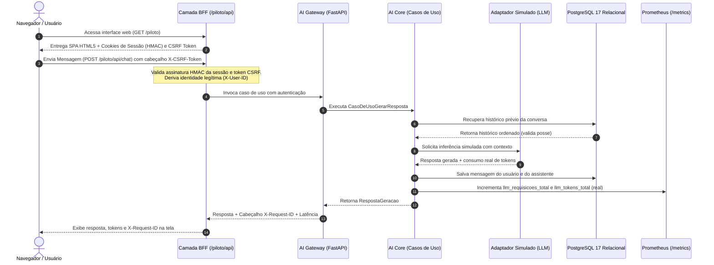

# Guia da Aplicação Piloto

Este documento descreve como executar, utilizar e validar a **Aplicação Piloto** da **Reusable AI Backend Architecture**.

---

## 1. Visão Geral e Fluxo Arquitetural

A aplicação piloto demonstra o consumo da arquitetura em um fluxo ponta a ponta sem frameworks pesados de frontend e com custo zero:



---

## 2. Mecanismos de Segurança Implementados

1. **Sessão com Assinatura Criptográfica HMAC-SHA256**:
   - Cookie `piloto_sessao`: `id_usuario.timestamp.hmac`.
   - Flags: `HttpOnly=True`, `SameSite="Lax"`, `Secure=True` (em HTTPS ou produção).
   - TTL de 24 horas; cookies adulterados ou forjados são sumariamente rejeitados.

2. **Proteção Anti-CSRF**:
   - Todas as requisições de alteração de estado (`POST /piloto/api/chat` e `POST /piloto/api/sessao`) exigem o envio do cabeçalho `X-CSRF-Token`.
   - O token CSRF é derivado criptograficamente da sessão via HMAC e comparado em tempo constante.

3. **Prevenção de Personificação e IDOR**:
   - O cliente web não pode forjar identificadores arbitrários nem especificar `id_usuario` no corpo das requisições de chat.
   - A alternância de perfis é restrita à lista estrita de demonstração (`usuario_alfa` e `usuario_beta`).
   - Tentativas de ler histórico de outro usuário no PostgreSQL são bloqueadas pelo banco com `403 Forbidden`.

4. **Governança Fail-Closed em Produção**:
   - Em produção (`ambiente="producao"`), o piloto é desabilitado por padrão (`piloto_ativo=False`), respondendo `404 Not Found`.
   - Se forçado com `GATEWAY_PILOTO_HABILITADO=true`, a alternância de perfis é bloqueada com `403 Forbidden`.

---

## 3. Instruções de Execução

### Pré-requisitos
- Docker Desktop ou Docker Engine com Docker Compose.

### Passo 1: Iniciar os Serviços
```bash
# Inicia o AI Gateway e o PostgreSQL 17 Alpine em background
docker compose up -d

# Confirma que os contêineres estão saudáveis
docker compose ps
```

### Passo 2: Acessar a Interface
Abra o navegador no endereço:
```text
http://localhost:8000/piloto
```

---

## 4. Roteiro de Demonstração e Homologação

### Cenário 1: Envio de Mensagem e Resposta do Modelo Simulado
1. Na interface, digite `"Mensagem 1: Olá! Qual o status do sistema?"` e clique em **Enviar**.
2. Observe o indicador de carregamento e a resposta retornada pelo `AdaptadorSimulado`.
3. No rodapé, note a exibição do **`X-Request-ID`**, do tempo de resposta (ms) e dos tokens processados.

### Cenário 2: Continuidade da Mesma Conversa (Histórico Persistido)
1. Na mesma conversa (`conv-piloto-01`), envie uma segunda mensagem: `"Mensagem 2: Segunda pergunta na mesma conversa"`.
2. O assistente responde mantendo o vínculo contextual da conversa.

### Cenário 3: Comprovação da Persistência no PostgreSQL
1. Clique no botão **"Recarregar"** da barra lateral.
2. A aplicação faz uma requisição `GET /piloto/api/conversas/conv-piloto-01` e reconstrói as 4 mensagens lidas diretamente das tabelas relacionais do PostgreSQL.

### Cenário 4: Demonstração de Isolamento Multilocatário (Anti-IDOR)
1. No seletor **Usuário Ativo (X-User-ID)**, alterne de `usuario_alfa` para `usuario_beta`.
2. A aplicação tentará consultar o histórico da conversa `conv-piloto-01`.
3. Uma mensagem de alerta em vermelho será exibida:
   > 🔒 **Acesso Negado (403 Forbidden)**: A conversa 'conv-piloto-01' pertence a outro usuário. O isolamento multilocatário e a proteção contra IDOR do PostgreSQL impedem o acesso por 'usuario_beta'.

### Cenário 5: Nova Conversa
1. Clique no botão **"Nova"** na barra lateral.
2. Um novo identificador (ex: `conv-20261028113000`) será atribuído para iniciar um tópico limpo no banco.

### Cenário 6: Observabilidade e Métricas Prometheus
1. Clique no link **"📊 Métricas Prometheus"** no topo da tela (ou abra `http://localhost:8000/metrics`).
2. Observe as métricas segregadas e fidedignas:
   - `llm_requisicoes_total{modelo="modelo-teste"}`: total de chamadas de geração efetuadas.
   - `llm_tokens_total{modelo="modelo-teste",tipo="entrada"}`: tokens de entrada.
   - `llm_tokens_total{modelo="modelo-teste",tipo="saida"}`: tokens de saída.
   - `llm_tokens_total{modelo="modelo-teste",tipo="total"}`: soma real dos tokens processados.
   - `persistencia_operacoes_total{operacao="salvar_mensagem",tipo_memoria="postgresql",...}`: transações gravadas no banco.
