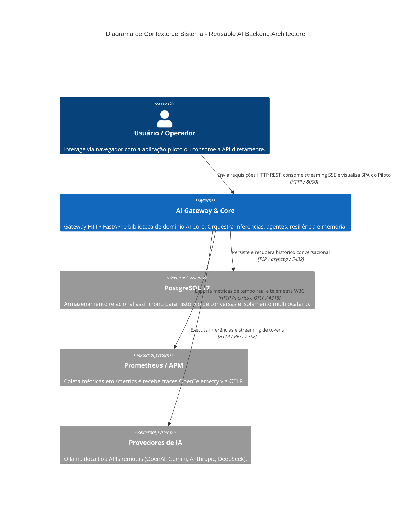
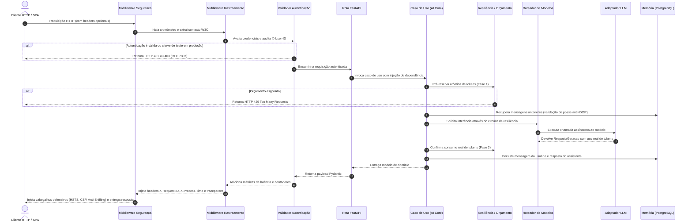
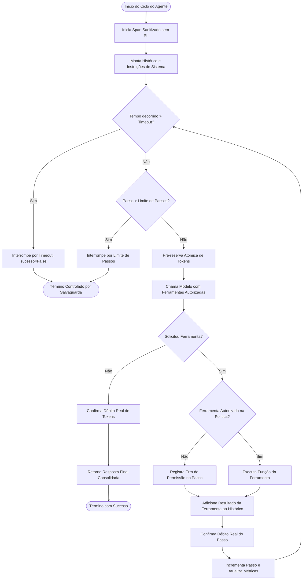
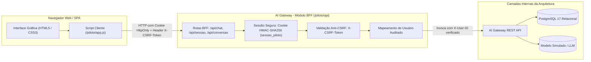

# Documentação de Arquitetura

Este documento descreve detalhadamente os padrões estruturais, camadas lógicas, fluxos de dados, modelos C4 e decisões de design implementados na **Reusable AI Backend Architecture**.

---

## 1. Visão Geral da Arquitetura

A plataforma adota uma arquitetura híbrida de nível corporativo, orientada pelos princípios de **Clean Architecture** (Robert C. Martin), **Arquitetura Hexagonal (Portas e Adaptadores)** (Alistair Cockburn), **SOLID** e **Monólito Modular**:

- **Domínio Puro e Agnóstico**: O pacote `ai-core` é estritamente isolado de frameworks web, transportes de rede HTTP ou SDKs comerciais proprietários.
- **Inversão de Dependência**: Todas as integrações com tecnologias externas (modelos de linguagem, bancos de dados, telemetria e ferramentas) são mediadas por contratos abstratos (portas).
- **Isolamento de Responsabilidades**: A camada de serviço HTTP (`ai-gateway`) atua apenas como adaptadora de transporte e orquestração de borda, sem acoplar regras de negócio de IA.

---

## 2. Diagramas de Arquitetura (Modelo C4)

### 2.1 C4 Nível 1 — Diagrama de Contexto de Sistema



### 2.2 C4 Nível 2 — Diagrama de Contêineres

```mermaid
C4Container
    title Diagrama de Contêineres - Arquitetura Local Conteinerizada

    Person(cliente, "Cliente HTTP / SPA", "Consumidor da API ou navegador na SPA do Piloto.")

    Container_Boundary(docker_stack, "Rede Interna Docker (ia_rede_interna)")
        Container(ai_gateway, "AI Gateway (FastAPI)", "Python 3.13, Uvicorn, Middlewares Defensivos", "Expõe rotas de inferência, contratos estruturados, BFF do piloto e métricas.")
        Container(ai_core, "AI Core (Biblioteca)", "Python 3.13, Domínio Puro", "Casos de uso, roteador de modelos, máquina de estados do disjuntor, orçamento e ReAct.")
        ContainerDb(postgres_db, "Banco de Dados (ia-postgres)", "PostgreSQL 17 Alpine", "Persistência transacional com isolamento multilocatário e migrações versionadas.")
        Container(ollama_srv, "Inferência Local (ia-ollama)", "Ollama Container (Opcional)", "Serviço de inferência local ativado sob demanda via profile.")
    Container_Boundary_End()

    Rel(cliente, ai_gateway, "Requisições HTTP / SSE", "JSON / Event-Stream na porta 8000")
    Rel(ai_gateway, ai_core, "Injeção de dependência e chamada de casos de uso", "Chamadas Python em memória")
    Rel(ai_core, postgres_db, "Leitura e escrita de histórico conversacional", "asyncpg pool")
    Rel(ai_core, ollama_srv, "Inferência local offline", "HTTP REST na porta 11434")
```

### 2.3 C4 Nível 3 — Diagrama de Componentes (Arquitetura Hexagonal Híbrida)

```mermaid
graph TD
    subgraph GatewayCamada ["Camada de Borda: services/ai-gateway"]
        Rotas["Roteadores FastAPI (/v1/chat, /v1/agentes, /piloto, /metrics)"]
        MidSec["MiddlewareCabecalhosSeguranca (HSTS, CSP, Anti-MIME)"]
        MidTrace["MiddlewareRastreamento (W3C traceparent, Request-ID, Latência)"]
        MidAuth["ValidadorAutenticacao (API Keys, Bearer, Anti-Spoofing X-User-ID)"]
        ErroHandler["Tratamento Global de Erros (RFC 7807 Problem Details)"]
    end

    subgraph CoreAplicacao ["Camada de Aplicação: packages/ai-core/aplicacao"]
        CasoGerar["CasoDeUsoGerarResposta"]
        CasoFluxo["CasoDeUsoGerarRespostaFluxo (Reserva Atômica 2-Fases)"]
        CasoEstruturado["CasoDeUsoGerarSaidaEstruturada (Auto-Reparo JSON)"]
        Orquestrador["OrquestradorAgente (Loop Cognitivo ReAct)"]
    end

    subgraph CoreDominio ["Camada de Domínio Puro: packages/ai-core/dominio"]
        Entidades["Modelos: Mensagem, RequisicaoGeracao, RespostaGeracao, Ferramenta"]
        PortaProvedor["PortaProvedorLLM"]
        PortaMemoria["PortaRepositorioMemoria"]
        PortaFerramenta["PortaExecutorFerramentas"]
        PortaObs["PortaObservabilidade"]
        Excecoes["Exceções de Domínio (ErroDominio, ErroValidacao, ErroDisjuntorAberto)"]
    end

    subgraph CoreResiliencia ["Camada de Resiliência: packages/ai-core/resiliencia"]
        Disjuntor["Disjuntor (Circuit Breaker com 3 Estados)"]
        Retentativa["PoliticaRetentativa (Backoff Exponencial + Jitter)"]
        Orcamento["PoliticaOrcamentoTokens (Reserva Atômica 2-Fases)"]
        Limitador["LimitadorTaxa (Token Bucket) & Semáforo"]
        Fallback["PoliticaFallback (Retaguarda em Cadeia)"]
    end

    subgraph AdaptadoresCamada ["Camada de Adaptadores: packages/ai-core/adaptadores"]
        AdpSimulado["AdaptadorSimulado (Mock determinístico)"]
        AdpOllama["AdaptadorOllama (Local)"]
        AdpComerciais["Adaptadores OpenAI / Gemini / Claude / DeepSeek"]
        AdpPostgres["MemoriaPostgresql (Pool asyncpg e Migrações)"]
        AdpSQLite["MemoriaSQLite (Modo WAL e Thread-Safe)"]
        AdpFerramentas["RegistroFerramentas & PoliticaAutorizacao"]
        AdpObs["MetricasPrometheus, GerenciadorRastreamento, FormatadorLogJson"]
    end

    Rotas --> MidSec --> MidTrace --> MidAuth --> CasoGerar & CasoFluxo & CasoEstruturado & Orquestrador
    CasoGerar & CasoFluxo & CasoEstruturado --> CoreResiliencia
    CasoGerar & CasoFluxo & Orquestrador --> CoreDominio
    
    PortaProvedor <|.. AdpSimulado & AdpOllama & AdpComerciais
    PortaMemoria <|.. AdpPostgres & AdpSQLite
    PortaFerramenta <|.. AdpFerramentas
    PortaObs <|.. AdpObs
```

---

## 3. Fluxo de Execução HTTP e Ciclo de Vida da Requisição

Cada requisição direcionada ao AI Gateway percorre um pipeline ordenado de defesas e observabilidade:



---

## 4. Ciclo Cognitivo de Agentes Autônomos (Padrão ReAct)

O `OrquestradorAgente` opera em um loop cognitivo seguro de Raciocínio e Ação com salvaguardas estritas:



---

## 5. Arquitetura da Camada Intermediária BFF (Aplicação Piloto)

A aplicação piloto adota o padrão **Backend-For-Frontend (BFF)** para isolar o navegador de credenciais sensíveis e de acessos diretos ao banco de dados:



---

## 6. Inventário de Adaptadores e Provedores LLM

A arquitetura implementa o desacoplamento de provedores através da `PortaProvedorLLM`. É fundamental distinguir os adaptadores prontos e testados das integrações reais com serviços externos pagos:

| Adaptador | Classe | Protocolo de Transporte | Status de Implementação | Status de Integração Verificada |
|---|---|---|---|---|
| **Simulado (Mock)** | `AdaptadorSimulado` | Memória / Determinístico | **Implementado** | **Totalmente Verificado** (utilizado na suíte de testes e na aplicação piloto com custo zero). |
| **Ollama** | `AdaptadorOllama` | HTTP REST (`/api/chat`, `/api/generate`) | **Implementado** | **Verificado Localmente** (via perfil Docker `ollama` com modelos locais). |
| **OpenAI** | `AdaptadorOpenAI` | HTTP REST / SSE (`/v1/chat/completions`) | **Implementado** | **Verificado via MockTransport** (contrato HTTP validado unitariamente; integração física com a API comercial em produção requer credencial válida do operador e homologação de tráfego real). |
| **Google Gemini** | `AdaptadorGemini` | HTTP REST (`models.generateContent`) | **Implementado** | **Verificado via MockTransport** (contrato HTTP validado unitariamente; integração física com a API comercial em produção requer credencial válida do operador e homologação de tráfego real). |
| **Anthropic** | `AdaptadorAnthropic` | HTTP REST (`/v1/messages`) | **Implementado** | **Verificado via MockTransport** (contrato HTTP validado unitariamente; integração física com a API comercial em produção requer credencial válida do operador e homologação de tráfego real). |
| **DeepSeek** | `AdaptadorDeepSeek` | HTTP REST compatível OpenAI | **Implementado** | **Verificado via MockTransport** (contrato HTTP validado unitariamente; integração física com a API comercial em produção requer credencial válida do operador e homologação de tráfego real). |

> [!NOTE]
> **Distinção entre Prontidão de Código e Integração em Nuvem**: Todos os adaptadores proprietários possuem lógica completa de serialização, desserialização, cabeçalhos e tratamento de erro, verificados com `MockTransport` (HTTPX) em testes automatizados. Nenhuma chamada externa a APIs comerciais pagas foi executada durante os testes e CI para assegurar custo financeiro zero e isolamento determinístico.

---

## 7. Referência aos Registros de Decisão de Arquitetura (ADRs)

Todas as decisões arquiteturais fundamentais estão formalizadas no diretório [`docs/adr/`](adr/):

- [ADR 0001: Arquitetura Híbrida e Padrão Hexagonal](adr/0001-arquitetura-hibrida-hexagonal.md)
- [ADR 0002: Nomenclatura em Português Brasileiro Culto](adr/0002-nomenclatura-em-portugues-brasileiro.md)
- [ADR 0003: Política de Resiliência, Disjuntor e Fallback](adr/0003-politica-resiliencia-disjuntor-e-fallback.md)
- [ADR 0004: Validação Rigorosa e Defesas de Borda](adr/0004-validacao-rigorosa-e-defesas-de-borda.md)
- [ADR 0005: Isolamento Multilocatário e Autorização de Conversas](adr/0005-isolamento-multilocatario-e-autorizacao-conversas.md)
- [ADR 0006: Controle de Identidade Anti-Spoofing e Persistência PostgreSQL](adr/0006-controle-identidade-anti-spoofing-e-persistencia-postgresql.md)
- [ADR 0007: Protocolo de Reserva Atômica de Tokens em Duas Fases](adr/0007-reserva-atomica-de-tokens-em-duas-fases.md)
- [ADR 0008: Conteinerização, Docker Compose e Orquestração Local](adr/0008-conteinerizacao-docker-compose-e-orquestracao-local.md)
- [ADR 0009: Observabilidade, Prometheus, OpenTelemetry e Rastreamento](adr/0009-observabilidade-prometheus-opentelemetry-e-rastreamento-distribuido.md)
- [ADR 0010: Aplicação Piloto e Interface BFF Segura](adr/0010-aplicacao-piloto-e-interface-bff-segura.md)
- [ADR 0011: Auditoria Estática e Remediação Conclusiva de Segurança](adr/0011-auditoria-e-remediacao-de-seguranca.md)

---

## 8. Limitações Arquiteturais e Riscos Operacionais Conhecidos

1. **Orçamento e Rate Limiting Confinados ao Processo Local**:
   - As estruturas de limitação de taxa (`LimitadorTaxa`) e reserva de cota (`PoliticaOrcamentoTokens`) utilizam sincronização por `asyncio.Lock()` em memória volátil. Em implantações horizontais com múltiplos contêineres/pods ou múltiplos workers Uvicorn, as quotas operam particionadas por processo, sem barreira consolidada global. Para clusters distribuídos, planeja-se a introdução de uma porta de coordenação (ex: Redis).
2. **Dependência de Reverse Proxies Autenticados para HSTS**:
   - Para prevenir *HSTS Spoofing* (RFC 6797 Sec 7.2), o Gateway não confia cegamente no cabeçalho `X-Forwarded-Proto` de clientes diretos. Em topologias de produção atrás de balanceadores/proxies (Cloudflare, AWS ALB, Nginx), o servidor Uvicorn deve ser configurado com `--proxy-headers` e `--forwarded-allow-ips`.
3. **Gestão de Segredos**:
   - As credenciais de produção (`GATEWAY_API_KEY`, `GATEWAY_PILOTO_SEGREDO_SESSAO`, `GATEWAY_METRICAS_TOKEN`) devem ser injetadas exclusivamente via variáveis de ambiente seguras ou cofres de segredos gerenciados (HashiCorp Vault, AWS Secrets Manager, GCP Secret Manager).
4. **Escopo dos Testes**:
   - A garantia de qualidade atual é fundamentada em 159 testes automatizados determinísticos e em auditoria estática com a Cloudflare Security Audit Skill. Testes dinâmicos de carga (DAST), injeção de falhas de rede sob alta concorrência e testes de penetração ativos devem ser conduzidos em ambiente de homologação antes de exposição pública irrestrita.
