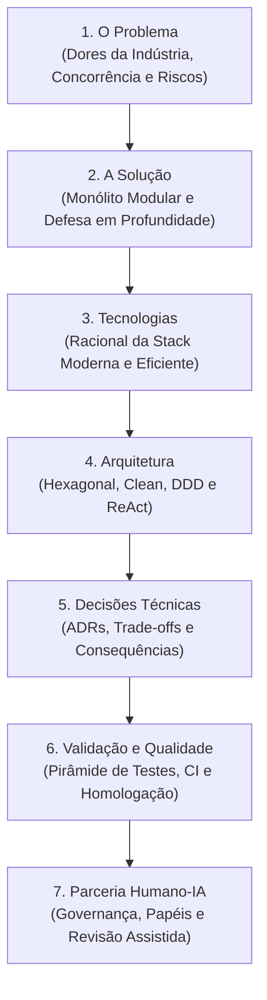
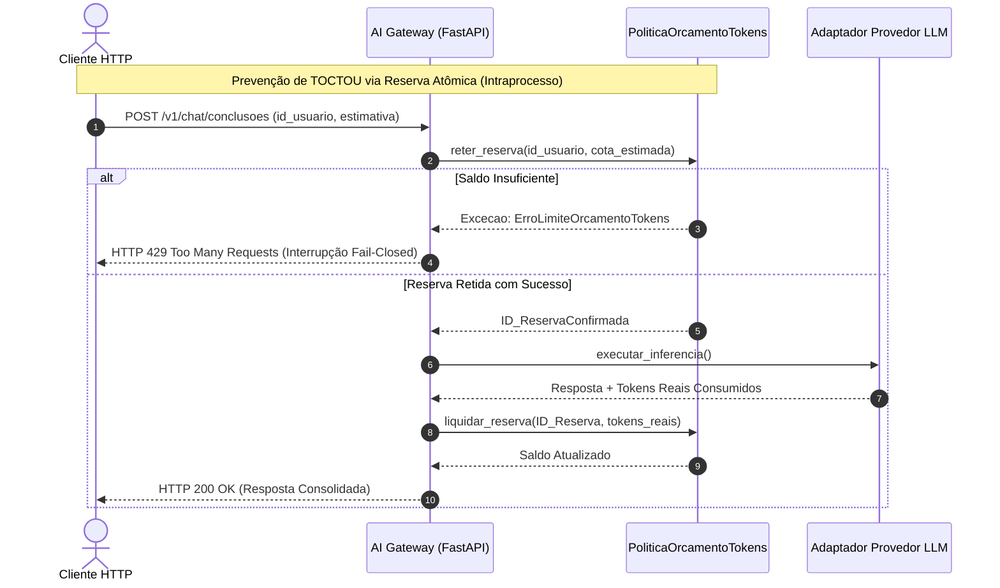
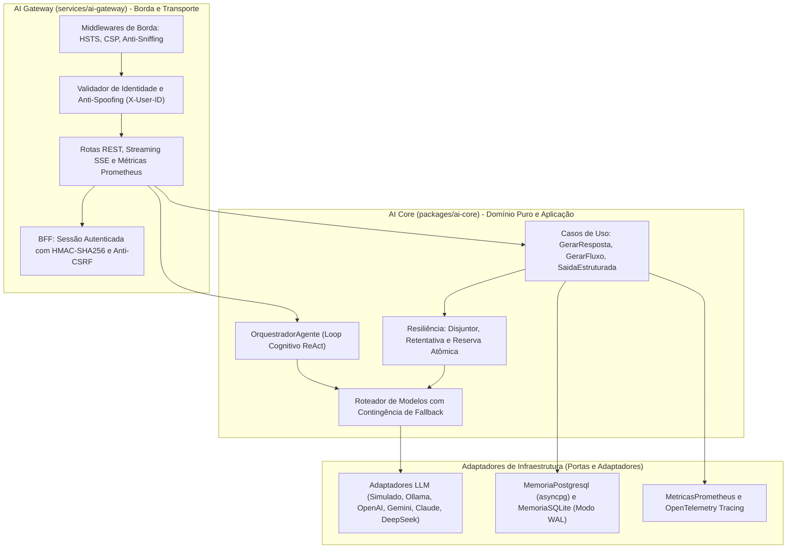
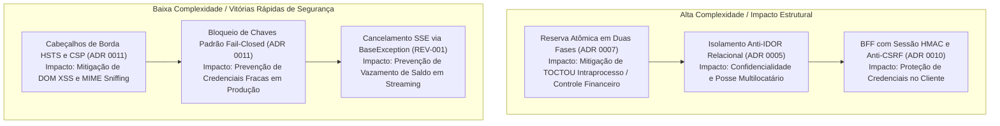
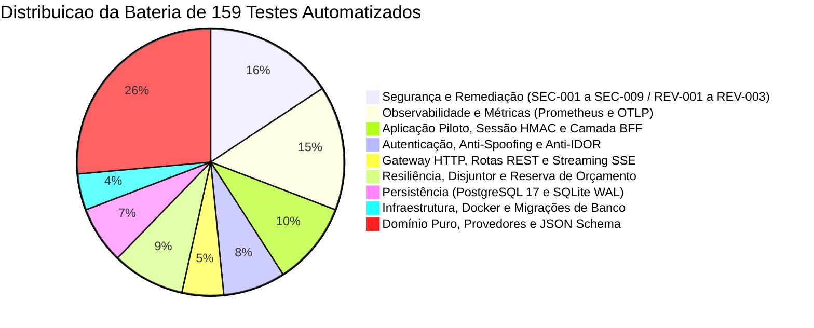
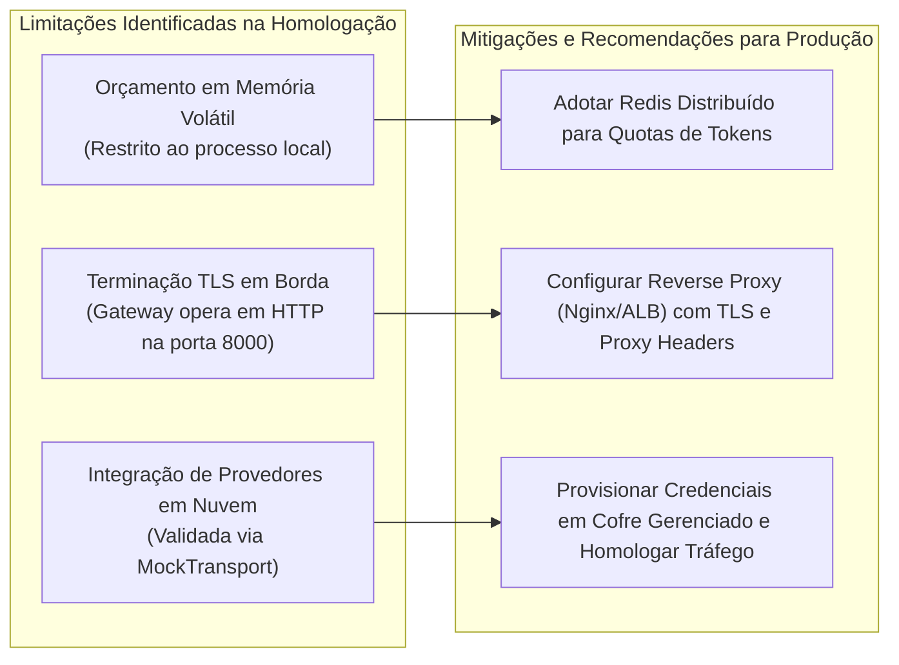
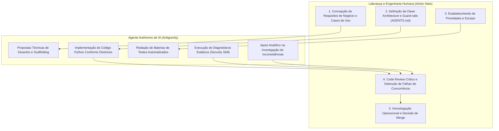

# Caderno Técnico de Engenharia de Software e Arquitetura de IA

**Projeto**: Reusable AI Backend Architecture  
**Autoria Técnica**: Airton Neto (Concepção, Direção Arquitetural e Governança) & Agente Autônomo Antigravity (Implementação Assistida por IA)  
**Data de Homologação**: 29 de Outubro de 2026  
**Versão**: 1.1.0  
**Commit Homologado**: `6d4c8ce7f652dfe4e69362af15c8a4f9eee51cdb`  

---

## Apresentação do Caderno Técnico

Este caderno técnico foi concebido como um guia aprofundado de engenharia de software corporativa, arquitetura de sistemas e material educacional avançado. Seu objetivo primordial é documentar a jornada de concepção, engenharia, blindagem de segurança, validação contínua e homologação empírica da plataforma **Reusable AI Backend Architecture**.

O documento está estruturado organicamente sobre **Sete Pilares Fundamentais da Engenharia**, complementados por uma seção especial dedicada às evidências de homologação em ambiente operacional:



---

## PILAR 1 — O Problema

### 1.1 Conceito Fundamental: Dores Estruturais na Integração de Modelos de Linguagem
A integração acelerada de Modelos de Linguagem de Larga Escala (LLMs) em aplicações empresariais revelou fragilidades críticas de engenharia de software. Diferentemente de microsserviços tradicionais com saídas determinísticas e tempos de resposta na casa dos milissegundos, sistemas baseados em IA generativa operam sob **inferência probabilística**, **alta latência de rede e processamento (1 a 30 segundos)**, **precificação variável por volume de tokens** e **modelos de ameaça específicos** (OWASP Top 10 for LLM Applications).

### 1.2 Explicação Progressiva: Por que Abordagens Ingênuas Falham sob Carga
Quando uma organização implementa soluções de IA sem arquitetura defensiva, depara-se com quatro gargalos severos:

1. **Acoplamento Proprietário ao Fornecedor (*Vendor Lock-in*)**:
   - A importação direta de SDKs de terceiros (como `openai`, `anthropic` ou `google-generativeai`) espalha contratos proprietários por rotas HTTP e regras de negócio. Uma oscilação de serviço ou mudança contratual de preços exige a reescrita invasiva de dezenas de arquivos do backend.
2. **Exaustão Orçamentária e Concorrência (*Token Spills* & TOCTOU)**:
   - LLMs cobram pelo volume cumulativo de tokens de entrada e saída. Em aplicações concorrentes, uma verificação ingênua de saldo antes do disparo (*Time-Of-Check to Time-Of-Use* — TOCTOU) permite que múltiplas requisições simultâneas encontrem saldo positivo e iniciem inferências caras em paralelo, estourando tetos orçamentários estabelecidos.
3. **Instabilidade Operacional e Ausência de Resiliência**:
   - Falhas transitórias de conectividade, saturação de cotas (HTTP 429 *Too Many Requests*) e instabilidades intermitentes de provedores externos derrubam transações de usuários caso não existam disjuntores (*circuit breakers*), retentativas com backoff exponencial e rotas de contingência (*fallback*).
4. **Vulnerabilidades de Borda e Violações de Locatário**:
   - A ausência de isolamento estrito de dados possibilita Acesso Indireto a Objetos (*Insecure Direct Object References* — IDOR), permitindo que um usuário visualize o histórico conversacional alheio. No frontend, respostas de modelos renderizadas sem higienização estruturada acarretam Cross-Site Scripting baseado em DOM (DOM XSS).

### 1.3 Aplicação Real no Projeto
O projeto endereça sistematicamente essas dores através de componentes dedicados:
- **Reserva Atômica em Duas Fases (Escopo Intraprocesso)**: Implementada na [`PoliticaOrcamentoTokens`](../packages/ai-core/src/ai_core/resiliencia/orcamento.py), que retém a estimativa máxima da cota orçamentária do usuário antes do envio da chamada e liquida o valor real consumido após a resposta. Suas garantias contra condições de corrida TOCTOU operam no escopo intraprocesso (concorrência assíncrona entre corrotinas locais via `asyncio.Lock`).
- **Barramento Relacional Anti-IDOR**: Implementado na verificação de propriedade no [`MemoriaPostgresql`](../packages/ai-core/src/ai_core/adaptadores/memoria/memoria_postgresql.py), validando a posse de cada sessão antes de liberar leituras ou gravações.
- **Higienização DOM XSS na Interface Piloto**: Implementada na camada visual através da função `escapeHtml()` no script desacoplado [`piloto.py`](../services/ai-gateway/src/ai_gateway/rotas/piloto.py) e servido como `/piloto/app.js`.

### 1.4 Código e Referências aos Componentes



### 1.5 Decisões e Trade-offs
- **Fail-Closed vs Fail-Open**: Em caso de incerteza, erro de configuração em ambiente de produção ou saldo insuficiente, o sistema adota comportamento *fail-closed* (bloqueia o tráfego com HTTP 429 via `manipulador_erro_dominio`). O *trade-off* é a recusa imediata de requisições que excedam o saldo em prol da proteção orçamentária do usuário.
- **Concorrência Local vs Distribuída**: A sincronização atual utiliza travas assíncronas em memória (`asyncio.Lock`). As garantias de concorrência e mitigação de TOCTOU aplicam-se estritamente ao processo local da aplicação. Em topologias escaladas horizontalmente com múltiplos workers Uvicorn ou réplicas de contêineres, impor um teto orçamentário consolidado exige um coordenador de estado distribuído externo (como Redis com scripts transacionais em Lua).

### 1.6 Exercício Prático
- **Desafio**: Analise o arquivo de testes [`tests/test_orcamento_tokens.py`](../tests/test_orcamento_tokens.py). Localize o teste de concorrência que dispara múltiplas reservas simultâneas e observe como o `asyncio.gather` tenta esgotar o saldo.
- **Tarefa**: Simule o que aconteceria caso a linha de reserva atômica fosse substituída por uma consulta simples `if saldo > 0: saldo -= gasto_real`. Qual seria o comportamento do saldo final sob concorrência de 10 requisições simultâneas com saldo para apenas 2?

### 1.7 Perguntas de Revisão
1. **Pergunta**: Por que a verificação de saldo pós-fato (*post-billing*) é vulnerável a condições de corrida TOCTOU em aplicações de IA?
   - *Resposta Comentada*: Porque requisições concorrentes disparadas no mesmo milissegundo leem o saldo antes de qualquer decremento, disparando chamadas externas simultâneas que excedem em muito o saldo disponível.
2. **Pergunta**: De que forma a alta latência intrínseca dos modelos generativos amplifica o risco de condições de corrida se comparada a microsserviços tradicionais?
   - *Resposta Comentada*: Quanto maior o tempo decorrido entre a verificação inicial e a finalização da requisição (segundos em vez de milissegundos), maior é a janela temporal de vulnerabilidade para que requisições concorrentes entrem no sistema.

---

## PILAR 2 — A Solução

### 2.1 Conceito Fundamental: Arquitetura Defensiva em Monólito Modular
A plataforma não é concebida como um mero intermediador (*wrapper*) superficial de requisições HTTP, mas sim como uma **arquitetura corporativa reutilizável** construída no formato de **Monólito Modular**. Essa topologia concilia o isolamento estrito de domínios com a simplicidade operacional de implantação, eliminando a complexidade prematura de rede e latência RPC inerente a microsserviços distribuídos.



### 2.2 Explicação Progressiva: As Duas Camadas do Sistema
1. **`AI Core` (`packages/ai-core`)**:
   - Biblioteca de domínio Python pura e desacoplada de transporte HTTP. Encapsula entidades de negócio, contratos abstratos (*ports*), suites de resiliência e o runtime de agentes autônomos. Pode ser importada em serviços FastAPI, workers Celery, funções serverless ou ferramentas CLI.
2. **`AI Gateway` (`services/ai-gateway`)**:
   - Serviço de borda HTTP construído com FastAPI. Gerencia autenticação de alta entropia, cabeçalhos de segurança (HSTS estrito, CSP sem scripts inline), barramento anti-spoofing em `X-User-ID`, métricas Prometheus e uma camada intermediária **BFF (Backend-For-Frontend)** com cookies HttpOnly autenticados por HMAC-SHA256 (código de autenticação de mensagem com chave simétrica) e tokens anti-CSRF.

### 2.3 Aplicação Real no Projeto
- **Streaming Resiliente e Cancelamento Seguro**: O [`caso_gerar_fluxo.py`](../packages/ai-core/src/ai_core/aplicacao/casos_de_uso/caso_gerar_fluxo.py) encapsula a emissão de pedaços em bloco `try...except BaseException...finally`. Quando o cliente desconecta antecipadamente (`asyncio.CancelledError`), a reserva orçamentária é liberada de forma atômica no processo local, prevenindo retenção indevida de saldo intraprocesso decorrente de streaming interrompido (`REV-001`).
- **Defesas Criptográficas Nativas**: Autenticação de integridade de mensagens com HMAC-SHA256 e validação em tempo constante com `hmac.compare_digest` para cookies e tokens anti-CSRF no [`piloto.py`](../services/ai-gateway/src/ai_gateway/rotas/piloto.py).
- **Injeção de Cabeçalhos de Borda**: O [`cabecalhos_seguranca.py`](../services/ai-gateway/src/ai_gateway/middlewares/cabecalhos_seguranca.py) injeta `X-Content-Type-Options: nosniff`, `X-Frame-Options: DENY`, `Referrer-Policy: strict-origin-when-cross-origin` e `Permissions-Policy`.

### 2.4 Decisões e Trade-offs
- **Custo Zero para Desenvolvimento vs Realismo de Nuvem**:
  - A arquitetura permite desenvolvimento e testes automatizados com custo financeiro zero utilizando o [`AdaptadorSimulado`](../packages/ai-core/src/ai_core/adaptadores/provedores/simulado.py) e inferência local via [`AdaptadorOllama`](../packages/ai-core/src/ai_core/adaptadores/provedores/ollama.py).
  - *Trade-off*: A validação de adaptadores de nuvem comerciais (OpenAI, Gemini, Anthropic, DeepSeek) é conduzida em testes unitários via `MockTransport` (HTTPX), validando esquemas e fluxos de transporte sem despesas com chamadas reais a APIs externas.

### 2.5 Exercício Prático
- **Desafio**: Abra [`services/ai-gateway/src/ai_gateway/middlewares/cabecalhos_seguranca.py`](../services/ai-gateway/src/ai_gateway/middlewares/cabecalhos_seguranca.py) e localize a condição que avalia a injeção do cabeçalho HSTS (`Strict-Transport-Security`).
- **Tarefa**: Identifique por que a implementação consulta `request.url.scheme == "https"` em vez de confiar cegamente no cabeçalho `X-Forwarded-Proto` de clientes diretos, conforme a RFC 6797 Seção 7.2.

### 2.6 Perguntas de Revisão
1. **Pergunta**: Qual a responsabilidade primordial da camada BFF na aplicação piloto em relação às credenciais de backend?
   - *Resposta Comentada*: A camada BFF atua como intermediária segura; o navegador nunca tem acesso a chaves mestras de API ou strings de conexão com o banco de dados, utilizando apenas identificadores de sessão protegidos por código de autenticação de mensagem baseado em hash (HMAC-SHA256 com chave simétrica compartilhada) em cookies HttpOnly (assegurando integridade e autenticidade contra falsificação de identidade sem envolver assinaturas digitais assimétricas ou necessidade de cifragem de payload).
2. **Pergunta**: Por que o gerador assíncrono de streaming SSE deve tratar `BaseException` em vez de apenas `Exception`?
   - *Resposta Comentada*: Em Python, `asyncio.CancelledError` e `GeneratorExit` herdam diretamente de `BaseException`. Se o tratador capturar apenas `Exception`, o cancelamento antecipado não aciona a limpeza no bloco `except`, causando retenção permanente de recursos e reservas.

---

## PILAR 3 — Tecnologias

### 3.1 Conceito Fundamental: Racionalidade Técnica e Simplicidade Operacional
A seleção da pilha tecnológica em um sistema de infraestrutura crítica deve priorizar: maturidade de ecossistema, desempenho sob operações assíncronas de I/O, segurança da cadeia de suprimentos (*supply chain*), tipagem estática rigorosa e facilidade de conteinerização.

### 3.2 Explicação Progressiva: Critérios de Escolha da Stack
Cada dependência foi escolhida por razões arquiteturais fundamentadas, evitando bibliotecas supérfluas que ampliem a superfície de ataque:

| Tecnologia | Papel no Projeto | Racional Técnico e Decisão Arquitetural |
|---|---|---|
| **Python 3.13** | Linguagem Principal | Versão moderna e estável com otimizações substanciais no interpretador, tipagem estática avançada e suporte completo a concorrência assíncrona. |
| **uv (Astral)** | Gerenciador de Pacotes e Workspace | Resolução e sincronização de dependências em milissegundos sobre lockfile determinístico (`uv.lock`), viabilizando monorrepositórios sem sobrecarga de npm/pip. |
| **FastAPI 0.115+** | Framework Web ASGI | Elevada performance assíncrona, validação nativa de contratos com Pydantic v2 e documentação OpenAPI gerada automaticamente a partir do código. |
| **asyncpg** | Driver de Banco de Dados | Driver assíncrono de mais alto desempenho para PostgreSQL em Python, implementando comunicação direta via protocolo binário sem camadas ORM intermediárias. |
| **PostgreSQL 17 Alpine** | Persistência Relacional Corporativa | Garantias ACID estritas, particionamento lógico multilocatário, suporte a JSONB para metadados e imagem conteinerizada mínima. |
| **SQLite (Modo WAL)** | Persistência Local Alternativa | Permite concorrência local de alta velocidade via *Write-Ahead Logging* (leitores não bloqueiam escritores e vice-versa), ideal para testes offline e execução sem Docker. |
| **OpenTelemetry SDK** | Instrumentação e Rastreamento | Padrão CNCF agnóstico para propagação de contexto W3C `traceparent` e exportação estruturada de telemetria sem expor PII. |
| **Prometheus Client** | Métricas Operacionais | Exportador de contadores e histogramas em formato canônico 0.0.4 com desenho estrito de baixa cardinalidade. |
| **Ruff** | Linter e Formatador | Ferramenta construída em Rust que substitui Black, Flake8 e isort em tempo quase instantâneo na esteira de CI. |
| **pip-audit** | Análise de SCA (*Supply Chain*) | Varredura contínua de vulnerabilidades conhecidas contra bases de CVEs oficiais (PyPI e OSV) no pipeline do GitHub Actions. |
| **Docker & Compose** | Conteinerização e Orquestração | Empacotamento multi-stage enxuto executando sob usuário não-privilegiado (`appuser`, UID `10001`). |

### 3.3 Código e Referências aos Arquivos Reais
- **Configuração de Dependências e Monorrepositório**: Definida no [`pyproject.toml`](../pyproject.toml) e bloqueada no `uv.lock`.
- **Orquestração Local dos Serviços**: Especificada no [`docker-compose.yml`](../docker-compose.yml), definindo healthchecks e isolamento de redes.
- **Instrumentação de Métricas**: Implementada no adaptador [`metricas_prometheus.py`](../packages/ai-core/src/ai_core/adaptadores/observabilidade/metricas_prometheus.py).

### 3.4 Decisões e Trade-offs
- **Adoção de `asyncpg` Direto vs ORM Tradicional**:
  - *Decisão*: Utilização do driver `asyncpg` com consultas SQL parametrizadas explícitas em vez de ORMs como SQLAlchemy ou Tortoise.
  - *Trade-off*: Abre-se mão de abstrações automáticas de geração de schema em troca de máximo controle sobre índices, planos de execução, ausência de latência de mapeamento relacional e prevenção nativa de injeção SQL através de bind parameters binários.

### 3.5 Exercício Prático
- **Desafio**: No terminal, execute a verificação estática de vulnerabilidades utilizando o `uv`:
  ```bash
  uv run --with pip-audit pip-audit
  ```
- **Tarefa**: Observe a saída do comando e verifique como os pacotes locais do monorrepositório (`ai-core` e `ai-gateway`) são tratados de forma isolada em relação às bibliotecas públicas auditadas.

### 3.6 Perguntas de Revisão
1. **Pergunta**: Por que a baixa cardinalidade é um requisito obrigatório no desenho de métricas com Prometheus?
   - *Resposta Comentada*: Porque cada combinação única de valores de rótulos (*labels*) cria uma nova série temporal em memória na base de dados do Prometheus. Rótulos de alta cardinalidade (como IDs de usuário ou payloads de requisição) causariam esgotamento de memória no servidor de monitoramento.
2. **Pergunta**: Qual a vantagem prática do build multi-stage adotado no `Dockerfile` da aplicação?
   - *Resposta Comentada*: O estágio de compilação utiliza o `uv` para baixar e compilar dependências; o estágio final copia apenas a árvore instalada para uma imagem base limpa (`python:3.13-slim`), resultando em contêineres menores e sem ferramentas de build que possam ser exploradas em caso de invasão.

---

## PILAR 4 — Arquitetura

### 4.1 Conceito Fundamental: Clean Architecture, Padrão Hexagonal e DDD
A integridade da plataforma fundamenta-se nos princípios de **Clean Architecture**, **Arquitetura Hexagonal (*Ports and Adapters*)** e conceitos de **Domain-Driven Design (DDD)**. A regra capital estabelece que: **o núcleo de domínio puro nunca depende de detalhes de transporte, persistência, frameworks web ou bibliotecas de terceiros**.

```mermaid
graph TD
    subgraph DominioPuro ["1. Núcleo de Domínio Puro (ai_core.dominio)"]
        Entidades["Entidades Imutáveis: Mensagem, RequisicaoGeracao, RespostaGeracao"]
        PortasAbstratas["Portas (Contratos ABC):<br/>- PortaProvedorLLM<br/>- PortaRepositorioMemoria<br/>- PortaExecutorFerramentas<br/>- PortaObservabilidade"]
        ServicosDominio["Serviços Puros: ValidadorEsquemaJson, PoliticaOrcamentoTokens"]
    end

    subgraph AplicacaoCamada ["2. Camada de Aplicação (ai_core.aplicacao)"]
        CasosDeUso["Casos de Uso:<br/>- CasoDeUsoGerarResposta<br/>- CasoDeUsoGerarRespostaFluxo<br/>- CasoDeUsoGerarSaidaEstruturada"]
        OrquestradorAgente["OrquestradorAgente (Loop ReAct com Salvaguardas)"]
    end

    subgraph AdaptadoresCamada ["3. Adaptadores de Infraestrutura (ai_core.adaptadores)"]
        AdaptadoresLLM["Provedores Concretos: Simulado, Ollama, OpenAI, Gemini, etc."]
        AdaptadoresDB["Persistência: MemoriaPostgresql, MemoriaSQLite"]
        AdaptadoresObs["Observabilidade: MetricasPrometheus, GerenciadorRastreamento"]
    end

    subgraph BordaTransporte ["4. Camada de Borda e Apresentação (ai_gateway)"]
        FastAPIRotas["Rotas HTTP/REST, Streaming SSE, BFF Piloto"]
        MiddlewaresBorda["Middlewares de Segurança, Injeção de Dependências"]
    end

    BordaTransporte --> AplicacaoCamada
    AplicacaoCamada --> DominioPuro
    AdaptadoresCamada ..|> PortasAbstratas
    AplicacaoCamada --> PortasAbstratas
```

### 4.2 Nomenclatura em Português Brasileiro Culto (ADR 0002)
Conforme formalizado na [ADR 0002](adr/0002-nomenclatura-em-portugues-brasileiro.md), todo o código-fonte proprietário, módulos, classes, métodos e variáveis adotam o **português brasileiro culto e idiomático** (`CasoDeUsoGerarResposta`, `PoliticaOrcamentoTokens`, `Disjuntor`, `id_usuario`, `total_tokens`):
- **Fundamentação Pedagógica e Corporativa**: Estabelece uma Linguagem Ubíqua (*Ubiquitous Language*) cristalina para equipes locais, eliminando a ambiguidade semântica de traduções literais truncadas (*Spanglish* ou traduções mecânicas).
- **Fronteira com Bibliotecas Externas**: Apenas palavras-chave intrínsecas da linguagem Python (`def`, `class`, `yield`, `async`, `await`) e contratos externos padronizados (`status_code`, `json`) permanecem em inglês.

### 4.3 Aplicação Real no Projeto
- **Portas Abstratas**: Veja a [`PortaProvedorLLM`](../packages/ai-core/src/ai_core/dominio/portas/porta_provedor.py). Ela define métodos assíncronos abstratos `gerar_resposta` e `gerar_resposta_fluxo`, sem qualquer menção a URLs, tokens de API ou bibliotecas de transporte HTTP.
- **Inversão de Dependência**: A injeção dos adaptadores concretos ocorre nas dependências do Gateway ([`dependencias.py`](../services/ai-gateway/src/ai_gateway/dependencias.py)), mantendo a camada de aplicação desacoplada.

### 4.4 Decisões e Trade-offs
- **Pureza de Domínio vs Facilidade de Transporte**:
  - *Decisão*: O pacote `ai-core` não importa `fastapi`, `starlette` ou `httpx` em seus modelos centrais.
  - *Trade-off*: Requer a existência de esquemas de mapeamento explícitos entre os modelos Pydantic de borda (`ai_gateway.esquemas`) e as entidades de domínio puro (`ai_core.dominio.modelos`). Esse isolamento previne que alterações contratuais de transporte contaminem as regras de negócio de IA.

### 4.5 Exercício Prático
- **Desafio**: Abra o arquivo [`packages/ai-core/src/ai_core/dominio/modelos/mensagem.py`](../packages/ai-core/src/ai_core/dominio/modelos/mensagem.py).
- **Tarefa**: Inspecione como as classes de dados de domínio são declaradas (`Mensagem`, `PapelMensagem`). Observe a ausência total de bibliotecas de transporte ou anotações acopladas a HTTP.

### 4.6 Perguntas de Revisão
1. **Pergunta**: Em que camada arquitetural da Clean Architecture reside a lógica do ciclo cognitivo ReAct do agente?
   - *Resposta Comentada*: Na camada de Aplicação (`ai_core.aplicacao.agentes.orquestrador`), orquestrando entidades de domínio e invocando portas abstratas de provedor e execução de ferramentas.
2. **Pergunta**: Qual o impacto prático da Inversão de Dependência na testabilidade de adaptadores de nuvem?
   - *Resposta Comentada*: Permite que os testes automatizados injetem o `AdaptadorSimulado` em vez de adaptadores comerciais, garantindo execuções determinísticas, instantâneas e sem custo de faturamento externo.

---

## PILAR 5 — Decisões Técnicas de Engenharia

### 5.1 Conceito Fundamental: Registros de Decisão de Arquitetura (ADRs)
Projetos de software robustos documentam suas escolhas fundamentais através de **Registros de Decisão de Arquitetura (ADRs)**. Uma ADR formaliza o contexto de negócio, as opções avaliadas, as forças técnicas em tensão e os *trade-offs* assumidos, garantindo a rastreabilidade histórica das decisões da engenharia.

### 5.2 Explicação Progressiva: Mapeamento das 11 ADRs do Projeto

| ADR | Título e Foco Técnico | Decisão de Engenharia Adotada | Trade-off Assumido |
|---|---|---|---|
| **[ADR 0001](adr/0001-arquitetura-hibrida-hexagonal.md)** | Monólito Modular Hexagonal | Monólito estruturado em dois pacotes (`ai-core` e `ai-gateway`). | Evita overhead prematuro de rede de microsserviços em prol de coesão inicial. |
| **[ADR 0002](adr/0002-nomenclatura-em-portugues-brasileiro.md)** | Nomenclatura em Português | Todo código proprietário em português brasileiro culto. | Requer convenção disciplinada da equipe; reforça Linguagem Ubíqua local. |
| **[ADR 0003](adr/0003-politica-resiliencia-disjuntor-e-fallback.md)** | Resiliência e Fallback | Disjuntor (*Circuit Breaker*) de 3 estados com rota de contingência. | Requer calibração de limiares de falha para evitar aberturas precoces. |
| **[ADR 0004](adr/0004-validacao-rigorosa-e-defesas-de-borda.md)** | Validação Rigorosa de Esquemas | Validador sintático JSON Schema com autocorreção. | Limita o volume de tentativas para evitar estouros de tempo de resposta. |
| **[ADR 0005](adr/0005-isolamento-multilocatario-e-autorizacao-conversas.md)** | Isolamento Multilocatário | Particionamento lógico estrito por `id_usuario`. | Impõe checagem relacional obrigatória antes de qualquer acesso. |
| **[ADR 0006](adr/0006-controle-identidade-anti-spoofing-e-persistencia-postgresql.md)** | Anti-Spoofing e PostgreSQL | Bloqueio de injeção direta de `X-User-ID` por clientes externos. | Exige delegação M2M explícita em gateway ou token de autenticação validado. |
| **[ADR 0007](adr/0007-reserva-atomica-de-tokens-em-duas-fases.md)** | Reserva Atômica de Tokens | Retenção prévia da cota máxima estimada antes da inferência. | Exige travas assíncronas e tratamento cuidadoso de cancelamento. |
| **[ADR 0008](adr/0008-conteinerizacao-docker-compose-e-orquestracao-local.md)** | Conteinerização Segura | Imagem multi-stage rodando sob usuário não-root (`appuser`). | Imagem imutável com volume externo mapeado para persistência. |
| **[ADR 0009](adr/0009-observabilidade-prometheus-opentelemetry-e-rastreamento-distribuido.md)** | Observabilidade e Tracing | Métricas Prometheus de baixa cardinalidade e spans OTel W3C. | Requer descarte explícito de PII e atributos de alta cardinalidade. |
| **[ADR 0010](adr/0010-aplicacao-piloto-e-interface-bff-segura.md)** | Aplicação Piloto e Camada BFF | SPA em HTML5/Vanilla JS com cookies HttpOnly autenticados via HMAC-SHA256 simétrico. | Zero dependências Node.js/npm; sem ecossistemas pesados de framework SPA. |
| **[ADR 0011](adr/0011-auditoria-e-remediacao-de-seguranca.md)** | Remediação de Segurança | Endurecimento SEC-001 a SEC-009 e revisões REV-001 a REV-003. | Eliminação de scripts inline (CSP) e remoção total de PII de traces. |

### 5.3 Diagrama de Categorização das Decisões de Arquitetura



### 5.4 Exercício Prático
- **Desafio**: Leia a [ADR 0010: Aplicação Piloto e Interface BFF Segura](adr/0010-aplicacao-piloto-e-interface-bff-segura.md).
- **Tarefa**: Escreva uma breve justificativa de três parágrafos avaliando em que momento da evolução do produto justificaria migrar a interface web de Vanilla JavaScript para um framework SPA corporativo (ex: Next.js ou Angular), apontando quais novos riscos de segurança e complexidades de build surgiriam.

### 5.5 Perguntas de Revisão
1. **Pergunta**: O que motivou a decisão de omitir totalmente identificadores de usuário dos spans OpenTelemetry na ADR 0011 (REV-003)?
   - *Resposta Comentada*: Em observabilidade distribuída enviada para coletores externos, mesmo identificadores pseudonimizados com hashes simples podem ser correlacionados ou sofrer ataques de dicionário, violando o princípio de minimização de dados da LGPD e GDPR.
2. **Pergunta**: Por que a ADR 0001 optou por um Monólito Modular em vez de microsserviços desacoplados desde o dia zero?
   - *Resposta Comentada*: Para evitar a latência adicional de chamadas de rede entre microsserviços, a complexidade de autenticação mútua distribuída (mTLS) e a sobrecarga de orquestração de contêineres, mantendo a capacidade de extrair módulos no futuro.

---

## PILAR 6 — Validação, Qualidade e Homologação Operacional

### 6.1 Conceito Fundamental: A Pirâmide de Testes e a Validação Empírica
A confiabilidade de uma arquitetura de missão crítica não decorre de declarações teóricas, mas de **verificação empírica, automatizada e reprodutível**. A estratégia adota uma pirâmide de testes rigorosa, combinando testes unitários isolados, testes de integração com banco de dados real e validação estática de segurança.



> [!NOTE]
> **Esclarecimento Metodológico sobre Métricas de Teste**:
> A aprovação de 100% dos testes coletados (159 de 159 cenários no CI) refere-se estritamente à **taxa de sucesso funcional dos testes executados pelo Pytest**. Essa métrica comprova que todos os cenários especificados estão em estrita conformidade, mas não deve ser confundida com medição formal de cobertura de código por linhas/ramos (*code coverage* de linhas via `pytest-cov`), cuja instrumentação completa não integra a esteira padrão.

---

### 6.2 Seção Especial: Evidências da Homologação Final (29/10/2026)

Em **29 de Outubro de 2026**, após a consolidação e integração dos Pull Requests #1 a #6 na branch `main` no commit **`6d4c8ce`**, foi conduzida a homologação técnica operacional da plataforma.

#### A. Ambiente Operacional Homologado
- **Host**: Windows 11 / WSL2.
- **Runtime Conteinerizado**: Docker Desktop com PostgreSQL 17 Alpine (`ia-postgres`) e AI Gateway (`ia-gateway`).
- **Runtime Local**: Python 3.13.14 executando sobre ambiente virtual gerenciado por `uv`.
- **Status dos Serviços**: Ambos os contêineres operando em estado `healthy` contínuo.

#### B. Evidências Empíricas Coletadas nos 14 Cenários de Teste

| # | Cenário Operacional Homologado | Método e Rota | Resposta HTTP | Evidência Técnica Registrada |
|---|---|---|---|---|
| 1 | Sonda de Vivacidade do Gateway | `GET /health` | **200 OK** | Resposta `{"status": "ok"}`; injeção de cabeçalhos de segurança de borda confirmada. |
| 2 | Catálogo de Modelos Registrados | `GET /v1/modelos` | **200 OK** | Acesso concedido mediante apresentação de token Bearer corporativo. |
| 3 | Conclusão Síncrona de Chat | `POST /v1/chat/conclusoes` | **200 OK** | Resposta simulada recebida; 13 tokens contabilizados; `X-Request-ID` propagado nos headers. |
| 4 | Streaming Assíncrono via SSE | `POST /v1/chat/conclusoes` | **200 OK** | `Content-Type: text/event-stream`; 9 chunks textuais emitidos e reconstituídos; finalização com `[DONE]`. |
| 5 | Cancelamento Antecipado de Streaming | `POST /v1/chat/conclusoes` | **200 OK** | Desconexão do cliente após chunk 2 tratada via `BaseException`; reserva atômica liberada sem vazamento de saldo (`REV-001`). |
| 6 | Geração Estruturada com JSON Schema | `POST /v1/chat/estruturado` | **200 OK** | Validação sintática e tratamento de falhas executados com tratamento gracioso de erro sem quebrar o gateway. |
| 7 | Loop Cognitivo de Agente ReAct | `POST /v1/agentes/executar` | **200 OK** | Agente executou com `sucesso: true`; limite de passos respeitado; resposta final entregue. |
| 8 | Persistência Relacional de Histórico | `POST` e `GET /v1/conversas/...` | **200 OK** | Mensagens gravadas e recuperadas com sucesso da tabela `mensagens_conversa` no PostgreSQL 17. |
| 9 | Barramento Relacional Anti-IDOR | `GET /v1/conversas/...` | **403 Forbidden** | Tentativa de leitura de histórico com `X-User-ID: usuario_invasor` rejeitada relacionalmente; evento registrado no Prometheus. |
| 10 | Interface Web da Aplicação Piloto | `GET /piloto` e `/piloto/app.js` | **200 OK** | HTML servido com CSP sem `'unsafe-inline'`; script estático (9.141 bytes) servido com tipo MIME `application/javascript`. |
| 11 | Camada BFF: Barramento Anti-CSRF | `POST /piloto/api/chat` | **403 Forbidden** | Tentativa de postagem sem cabeçalho `X-CSRF-Token` rejeitada imediatamente com HTTP 403. |
| 12 | Camada BFF: Postagem Autorizada | `POST /piloto/api/chat` | **200 OK** | Requisição intermediada com cookie autenticado por HMAC e token CSRF aceita; latência de 9.9 ms. |
| 13 | Camada BFF: Alternância Multilocatário | `POST /piloto/api/sessao` | **200 OK** | Troca controlada de `usuario_alfa` para `usuario_beta` gerando novo cookie e token CSRF. |
| 14 | Exposição de Métricas Prometheus | `GET /metrics` | **200 OK** | 340 linhas exportadas; contadores `http_requisicoes_total` e contadores de bloqueio IDOR confirmados. |

#### C. Integridade do Banco de Dados PostgreSQL 17
A inspeção direta no banco `ia_conversas` através do utilitário `psql` confirmou:
- Tabela `schema_migracoes`: Migrações 1 (`conversas_proprietarios`) e 2 (`mensagens_conversa`) aplicadas de forma idempotente.
- Persistência efetiva: 6 conversas e 18 mensagens mantidas de forma durável no volume `dados_postgresql`.

#### D. Quadro de Limitações Técnicas e Riscos Residuais



> [!IMPORTANT]
> **Distinção entre Evidência Interna, Automação e Auditoria Externa**:
> 1. **Evidência Interna Registrada**: Os 14 cenários acima representam dados empíricos observados na execução local homologada em 29/10/2026.
> 2. **Verificação Automatizada**: A esteira de CI do GitHub Actions executa e aprova continuamente 159 cenários de teste automatizados determinísticos contra um banco PostgreSQL real.
> 3. **Auditoria Externa**: A revisão de segurança foi orientada pela *Cloudflare Security Audit Skill*; **ela não constitui certificação formal acreditada por terceiros (como SOC 2, ISO 27001 ou PCI-DSS)**, recomendando-se testes de invasão (*pentest*) dinâmicos prévios à exposição pública.

---

### 6.3 Exercício Prático
- **Desafio**: No terminal, execute a suíte de testes de remediação de segurança:
  ```bash
  uv run pytest tests/test_remediacao_auditoria_seguranca.py -v
  ```
- **Tarefa**: Localize os testes correspondentes a `test_revisao_pr5_etapa1_streaming_cancelamento_asyncio_cancela_reserva` e `test_sec008_metricas_producao_sem_token_retorna_403_fail_closed`. Explique como esses testes garantem o comportamento *fail-closed*.

### 6.4 Perguntas de Revisão
1. **Pergunta**: Por que a verificação de integridade do PostgreSQL confirmou a presença da tabela `schema_migracoes`?
   - *Resposta Comentada*: Porque a aplicação adota migrações de banco idempotentes no bootstrap; a tabela rastreia quais scripts de migração já foram executados, prevenindo que recriações de contêiner executem comandos DDL destrutivos sobre dados existentes.
2. **Pergunta**: Como o teste de IDOR comprova que o isolamento multilocatário não depende apenas de convenções no frontend?
   - *Resposta Comentada*: O teste envia uma chamada direta à API REST com o token de autorização de um invasor e o ID de conversa de outro usuário; o banco de dados executa a query com `WHERE id_conversa = $1 AND id_usuario = $2`, retornando zero registros e fazendo o Gateway devolver **HTTP 403 Forbidden**.

---

## PILAR 7 — Minha Participação e o Modelo de Parceria Humano-IA

### 7.1 Conceito Fundamental: Engenharia de Software Assistida por IA sob Governança Rigorosa
O desenvolvimento deste repositório representa um estudo de vanguarda no paradigma de **Engenharia de Software Assistida por Inteligência Artificial**. Longe de constituir geração desordenada de código (*prompt engineering* ingênuo), o projeto baseia-se em uma divisão de responsabilidades estrita e transparente entre a liderança técnica humana e o suporte autônomo dos agentes de IA.



### 7.2 Matriz de Divisão de Papéis e Responsabilidades

| Dimensão da Engenharia | Atribuição Humana (Airton Neto) | Atribuição dos Agentes de IA (Antigravity) |
|---|---|---|
| **Concepção Estratégica** | Definição das dores da indústria, objetivos do produto, modelo de monólito modular e política de custos. | Sugestão de contratos de dados e propostas técnicas de desenho de interfaces. |
| **Arquitetura e Governança** | Imposição da Clean Architecture, portas e adaptadores, e regras estritas de nomenclatura em português em `AGENTS.md`. | Estruturação dos pacotes `ai-core` e `ai-gateway` seguindo os padrões definidos. |
| **Implementação de Código** | Supervisão de conformidade de design, restrição de dependências e rejeição de alucinações. | Geração das classes de domínio, adaptadores, middlewares e endpoints FastAPI. |
| **Garantia de Qualidade** | Definição dos cenários críticos de teste e aprovação dos critérios de aceitação. | Escrita técnica de 159 testes unitários e de integração com asserções detalhadas. |
| **Segurança da Informação** | Decisão de implementar modo *fail-closed*, proibição de segredos padrão e diretriz de minimização de dados. | Execução sistemática do roteiro da Cloudflare Security Audit Skill e proposta de remediações. |
| **Integração e Release** | Autorização soberana de commits, revisão de diffs e aprovação final de merges nos PRs #1 a #6. | Geração de documentação técnica, redação de relatórios e execução de comandos de CI. |

### 7.3 O Processo Colaborativo de Revisão Assistida por IA (Revisões REV-001 a REV-003)
Durante a revisão de código do Pull Request #5, o processo colaborativo assistido por IA exemplificou o potencial da engenharia em parceria:

1. **REV-001 — Cancelamento em Streaming SSE**:
   - *Problema Identificado*: O tratamento original de exceções no gerador assíncrono capturava apenas `except Exception`. A investigação colaborativa constatou que clientes desconectados prematuramente emitiam `asyncio.CancelledError` (subclasse de `BaseException`), impedindo a liberação da reserva atômica de tokens retida na `PoliticaOrcamentoTokens`.
   - *Solução Aplicada*: Encapsulamento em bloco `try...except BaseException...finally` com controle atômico booleano, assegurando a liquidação ou cancelamento da reserva em qualquer circunstância de interrupção.
2. **REV-002 — Prevenção de HSTS Spoofing (RFC 6797 Sec 7.2)**:
   - *Problema Identificado*: A injeção do cabeçalho HSTS verificava diretamente o cabeçalho `X-Forwarded-Proto`. Uma análise técnica apontou que clientes maliciosos sobre HTTP puro poderiam forjar esse cabeçalho para induzir o navegador a forçar HTTPS em domínios sem certificado válido.
   - *Solução Aplicada*: Restrição da verificação a `request.url.scheme == "https"`, populado exclusivamente pelo servidor ASGI quando adequadamente configurado com proxies autorizados.
3. **REV-003 — Minimização de Dados em Spans OpenTelemetry**:
   - *Problema Identificado*: A proposta de telemetria inicial cogitava enviar hashes de identificadores de usuários nos atributos de traces. Avaliou-se que mesmo hashes com salt podem ser vulneráveis a ataques de força bruta em vocabulários restritos, violando os princípios de minimização da LGPD e GDPR.
   - *Solução Aplicada*: Remoção total de qualquer referência a identificadores de usuário dos spans distribuídos, mantendo a correlação restrita ao `X-Request-ID` e `X-Trace-ID` efêmeros.

### 7.4 Decisões e Trade-offs
- **Geração Assistida vs Intervenção Manual Direta**:
  - *Decisão*: Utilizar agentes autônomos para tarefas de alto esforço braçal (scaffolding, implementação de classes, escrita extensiva de testes e documentação padronizada), mantendo as decisões conceituais, as revisões críticas de segurança e as autorizações de merge sob controle humano.
  - *Trade-off*: Exige um esforço rigoroso de governança e code review para evitar que códigos inconsistentes sejam integrados sem escrutínio.

### 7.5 Exercício Prático
- **Desafio**: Examine o documento de governança [`AGENTS.md`](../AGENTS.md).
- **Tarefa**: Identifique como a regra de governança que exige nomenclatura em português brasileiro influenciou a legibilidade do código nos casos de uso e analise quais salvaguardas adicionais poderiam ser adicionadas para prevenir alucinações de SDKs não autorizados.

### 7.6 Perguntas de Revisão
1. **Pergunta**: Por que a supervisão humana é indispensável mesmo quando agentes autônomos de IA atingem 100% de aprovação em testes automatizados?
   - *Resposta Comentada*: Porque testes automatizados validam apenas os cenários que foram explicitamente programados. A liderança humana é responsável por avaliar riscos não modelados, conformidade regulatória, implicações financeiras e a adequação arquitetural estratégica do sistema como um todo.
2. **Pergunta**: De que forma as regras operacionais do `AGENTS.md` previnem que agentes de IA violem os limites de Clean Architecture?
   - *Resposta Comentada*: O documento `AGENTS.md` atua como protocolo de governança comportamental e meta-instrução para agentes autônomos e desenvolvedores, proibindo explicitamente que a camada de domínio puro importe frameworks web (`fastapi`, `starlette`) ou bibliotecas de transporte HTTP. Trata-se de uma diretriz de governança operacional e de orientação para o code review humano; o projeto não possui atualmente um linter arquitetural dedicado (ex: *import-linter* ou análise AST no CI) para barramento puramente automatizado dessa regra, dependendo da disciplina de autoria e da revisão técnica humana.

---

## Conclusão Geral e Bibliografia Recomendada

A jornada de desenvolvimento e homologação da **Reusable AI Backend Architecture** demonstra que sistemas confiáveis baseados em Inteligência Artificial demandam, antes de mais nada, **excelência clássica em Engenharia de Software**. 

Modelos estatísticos probabilísticos tornam-se soluções empresariais perenes e seguras apenas quando envolvidos por:
- Domínios desacoplados via Arquitetura Hexagonal.
- Protocolos atômicos de reserva orçamentária contra concorrência TOCTOU intraprocesso.
- Persistência relacional protegida contra vulnerabilidades de autorização (anti-IDOR).
- Camadas intermediárias seguras (BFF) com cookies de sessão autenticados com HMAC-SHA256 e proteção anti-CSRF.
- Esteiras de teste determinísticas e observabilidade contínua de baixa cardinalidade.

### Referências Recomendadas para Estudo Continuado
1. **Martin, Robert C.** — *Clean Architecture: A Craftsman's Guide to Software Structure and Design*. Prentice Hall, 2017.
2. **Evans, Eric** — *Domain-Driven Design: Tackling Complexity in the Heart of Software*. Addison-Wesley, 2003.
3. **OWASP Foundation** — *OWASP Top 10 for Large Language Model Applications*, v2025.
4. **IETF RFC 6797** — *HTTP Strict Transport Security (HSTS)*, Seção 7.2.
5. **OpenTelemetry Project** — *OpenTelemetry Specification & Semantic Conventions for Generative AI Systems*, CNCF, 2026.
