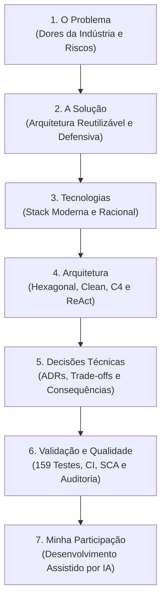
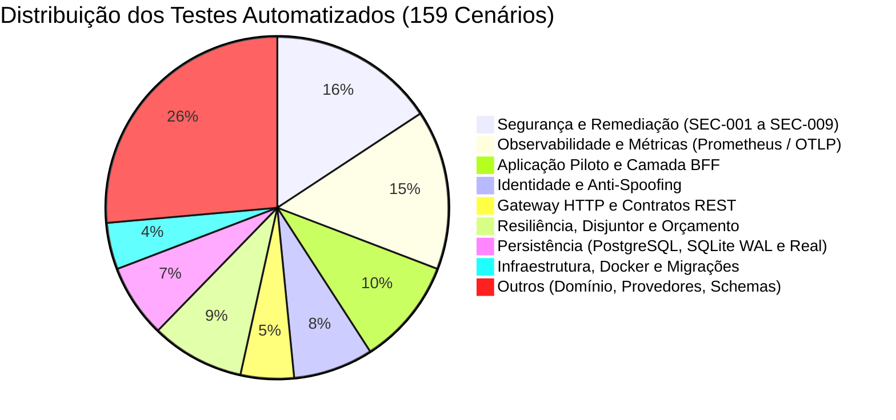
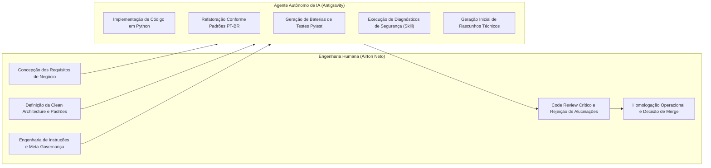

# Caderno Técnico de Engenharia de Software e Arquitetura de IA

**Projeto**: Reusable AI Backend Architecture  
**Autoria Técnica**: Airton Neto (Concepção, Direção Arquitetural e Governança) & Agente Autônomo Antigravity (Implementação Assistida por IA)  
**Data de Consolidação**: 29 de Outubro de 2026  
**Versão**: 1.0.0  

---

## Apresentação do Caderno Técnico

Este caderno técnico foi estruturado como um guia aprofundado de engenharia de software corporativa, arquitetura de sistemas e estudo prático. Seu objetivo é documentar a jornada de concepção, engenharia, blindagem e validação da plataforma **Reusable AI Backend Architecture**, fundamentando-se em **Sete Pilares Essenciais**:



---

## PILAR 1 — O Problema

### 1.1 Contexto e Dores Reais da Indústria
A explosão do consumo de Modelos de Linguagem de Larga Escala (LLMs) levou inúmeras empresas a construírem soluções apressadas. Na prática, grande parte dessas iniciativas manifesta graves anti-padrões:

1. **Acoplamento Extremo ao Fornecedor (*Vendor Lock-in*)**: Aplicações inteiras escritas importando diretamente SDKs proprietários (como `openai` ou `google-generativeai`) espalhados por controladores HTTP, rotas e regras de negócio. A substituição ou contingência de um provedor exige reescrever dezenas de arquivos.
2. **Ausência de Governança de Custos e Faturamento (*Token Spills*)**: LLMs são cobrados por volume de tokens. Requisições concorrentes, laços infinitos de agentes e chamadas não limitadas podem consumir milhares de dólares em poucos minutos decorrentes de ataques de exaustão ou erros de programação.
3. **Fragilidade Operacional e Falta de Resiliência**: APIs de IA sofrem frequentes oscilações de latência, degradação de desempenho e erros de *Rate Limit* (HTTP 429). Aplicações ingênuas propagam essas falhas diretamente aos usuários finais.
4. **Vulnerabilidades Críticas de Segurança (OWASP Top 10 for LLM)**:
   - Exposição de chaves mestras e strings de conexão no frontend.
   - Cross-Site Scripting Baseado em DOM (DOM XSS) através de respostas não tratadas do modelo.
   - Ausência de isolamento multilocatário, permitindo Acesso Indireto a Objetos (IDOR), onde um usuário visualiza o histórico conversacional alheio.
   - Falsificação de identidade (*Spoofing*) em serviços intermediários.
5. **Observabilidade Opaque**: Dificuldade em correlacionar qual usuário consumiu determinada quantidade de tokens, qual foi a latência de inferência versus a latência de banco de dados e ausência de rastreabilidade ponta a ponta.

### 1.2 Exemplos Práticos no Projeto
O projeto endereça essas dores reais nas seguintes frentes:
- **Prevenção de Esgotamento Orçamentário**: Implementada no protocolo de reserva em duas fases na [`PoliticaOrcamentoTokens`](../packages/ai-core/src/ai_core/resiliencia/orcamento.py).
- **Proteção contra IDOR Relacional**: Implementada na verificação de posse do usuário no [`MemoriaPostgresql`](../packages/ai-core/src/ai_core/adaptadores/memoria/memoria_postgresql.py).
- **Eliminação de DOM XSS**: Implementada na higienização de saída na SPA do piloto em [`piloto.py`](../services/ai-gateway/src/ai_gateway/rotas/piloto.py).

### 1.3 Conceitos Técnicos Importantes
- **TOCTOU (*Time-Of-Check to Time-Of-Use*)**: Condição de corrida onde múltiplas requisições simultâneas verificam que há saldo orçamentário disponível e disparam juntas antes que o saldo seja decrementado, estourando a cota orçamentária da sessão.
- **Fail-Closed vs Fail-Open**: Prática de engenharia onde um sistema falha bloqueando o acesso e abortando a operação (fechado), em oposição a permitir o tráfego em caso de incerteza (aberto).

### 1.4 Questões de Revisão e Exercício Prático
- **Pergunta**: Por que verificar o saldo de tokens antes da requisição não é suficiente sem um mecanismo de reserva atômica?
- **Exercício Prático**: Inspecione o teste [`test_sec006_streaming_reserva_e_consome_tokens_no_orcamento`](../tests/test_remediacao_auditoria_seguranca.py) e observe como a cota estimada é retida antes do primeiro chunk do streaming.

---

## PILAR 2 — A Solução

### 2.1 Visão da Plataforma Reutilizável
A solução construída não é um mero *wrapper* de chamadas HTTP. É uma arquitetura de referência completa e reutilizável em formato de **Monólito Modular** dividida em duas camadas fundamentais:

1. **`AI Core` (`packages/ai-core`)**: Uma biblioteca de domínio Python pura, transport-agnostic, que encapsula entidades, portas abstratas, políticas de resiliência e o runtime ReAct. Pode ser embarcada em microsserviços, workers Celery, funções serverless ou CLIs.
2. **`AI Gateway` (`services/ai-gateway`)**: O serviço de borda HTTP construído com FastAPI, responsável por autenticação de alta entropia, cabeçalhos de segurança, auditoria anti-spoofing, métricas Prometheus e camada BFF.

### 2.2 Características Distintivas da Solução
- **Custo Zero para Desenvolvimento e Homologação**: A arquitetura opera 100% offline utilizando o [`AdaptadorSimulado`](../packages/ai-core/src/ai_core/adaptadores/provedores/simulado.py) e inferência local via [`AdaptadorOllama`](../packages/ai-core/src/ai_core/adaptadores/provedores/ollama.py). Nenhum centavo é gasto em testes automatizados.
- **Defesas Criptográficas Nativas**: Uso de HMAC-SHA256 para assinatura de sessões web e tokens anti-CSRF, comparação em tempo constante com `hmac.compare_digest` e geração segura via `secrets`.
- **Persistência Relacional Corporativa**: Histórico mantido no **PostgreSQL 17** com particionamento lógico por usuário, pool de conexões assíncrono e migrações idempotentes no startup.

### 2.3 Referências aos Arquivos Reais
- **Caso de Uso de Streaming Resiliente**: [`caso_gerar_fluxo.py`](../packages/ai-core/src/ai_core/aplicacao/casos_de_uso/caso_gerar_fluxo.py)
- **Middleware de Cabeçalhos de Borda**: [`cabecalhos_seguranca.py`](../services/ai-gateway/src/ai_gateway/middlewares/cabecalhos_seguranca.py)
- **Interface Gráfica e BFF**: [`piloto.py`](../services/ai-gateway/src/ai_gateway/rotas/piloto.py)

---

## PILAR 3 — Tecnologias

### 3.1 Racional de Escolha das Ferramentas
A seleção tecnológica priorizou maturidade, desempenho, tipagem estática rigorosa e simplicidade operacional:

| Tecnologia | Papel no Projeto | Racional Técnico |
|---|---|---|
| **Python 3.13** | Linguagem Principal | Adoção da versão estável mais moderna, suporte aprimorado a tipagem estática e otimizações de runtime. |
| **uv (Astral)** | Gerenciador de Pacotes e Workspace | Resolução de dependências em milissegundos, lockfile determinístico (`uv.lock`) e suporte nativo a monorrepositórios. |
| **FastAPI** | Framework Web Assíncrono | Alta performance sobre ASGI (Uvicorn), validação automática com Pydantic v2 e documentação OpenAPI nativa. |
| **asyncpg** | Driver PostgreSQL | O driver PostgreSQL mais rápido do ecossistema Python, operando em protocolo binário assíncrono sem bloqueio de I/O. |
| **PostgreSQL 17 Alpine** | Banco de Dados Relacional | Confiabilidade ACID, suporte nativo a JSONB e isolamento relacional multilocatário. |
| **SQLite (Modo WAL)** | Persistência Local Alternativa | Ideal para execuções desktop, ambientes sem contêineres e testes de concorrência com Write-Ahead Logging. |
| **OpenTelemetry SDK** | Rastreamento Distribuído | Padrão da Cloud Native Computing Foundation (CNCF), propagação W3C `traceparent` e compatibilidade com coletores OTLP. |
| **Prometheus Client** | Métricas Operacionais | Exposição em formato texto padrão 0.0.4 com garantia de baixa cardinalidade. |
| **Ruff** | Linter e Formatador | Executado em Rust, substitui Flake8, Black e isort com velocidade quase instantânea. |
| **pip-audit** | Análise de Segurança (SCA) | Varredura de dependências contra bases de vulnerabilidades conhecidas (PyPI e OSV) em tempo de CI. |
| **Docker & Compose** | Conteinerização e Orquestração | Empacotamento multi-stage seguro executando sob usuário não-root (`appuser`). |

### 3.2 Questões de Revisão
- **Pergunta**: Qual a vantagem do modo WAL (*Write-Ahead Logging*) no SQLite para aplicações com concorrência assíncrona?
- **Resposta**: No modo padrão de rollback journal, leituras e escritas bloqueiam-se mutuamente. No modo WAL, leitores não bloqueiam escritores e escritores não bloqueiam leitores, permitindo alta concorrência intraprocesso.

---

## PILAR 4 — Arquitetura

### 4.1 Clean Architecture e Padrão Hexagonal
O projeto organiza-se estritamente de fora para dentro, onde o domínio puro nunca depende de detalhes de infraestrutura:

```mermaid
graph TD
    subgraph DominioPuro ["Núcleo de Domínio Puro (Sem Frameworks)"]
        Modelos["Entidades Imutáveis: Mensagem, Requisicao, Resposta"]
        Portas["Portas Abstratas: PortaProvedorLLM, PortaRepositorioMemoria, PortaExecutorFerramentas"]
    end

    subgraph Aplicacao ["Casos de Uso e Orquestração"]
        Casos["CasoDeUsoGerarResposta, CasoDeUsoGerarRespostaFluxo, CasoDeUsoGerarSaidaEstruturada"]
        Orquestrador["OrquestradorAgente (Loop ReAct)"]
    end

    subgraph Adaptadores ["Adaptadores Concretos (Infraestrutura)"]
        Provedores["AdaptadorSimulado, AdaptadorOllama, AdaptadorOpenAI, etc."]
        Bancos["MemoriaPostgresql (asyncpg), MemoriaSQLite (WAL)"]
        Telemetria["MetricasPrometheus, GerenciadorRastreamento, FormatadorLogJson"]
    end

    subgraph InterfaceBorda ["Camada de Borda HTTP (AI Gateway)"]
        Rotas["FastAPI, Middlewares HSTS/CSP, Injeção de Dependências, BFF"]
    end

    InterfaceBorda --> Aplicacao
    Aplicacao --> DominioPuro
    Adaptadores ..|> Portas
    Aplicacao --> Portas
```

### 4.2 Nomenclatura em Português Brasileiro Culto
Conforme a [ADR 0002](adr/0002-nomenclatura-em-portugues-brasileiro.md), todo o código-fonte proprietário, módulos, classes, métodos e variáveis utilizam o português brasileiro culto e idiomático (`CasoDeUsoGerarResposta`, `PoliticaOrcamentoTokens`, `Disjuntor`, `id_usuario`).
- **Por quê?** Elimina a ambiguidade semântica de traduções literais truncadas, valoriza a clareza conceitual na modelagem de domínio e estabelece uma Linguagem Ubíqua (*Ubiquitous Language*) cristalina para equipes de engenharia de software locais.

---

## PILAR 5 — Decisões Técnicas de Engenharia

O projeto conta com onze Registros de Decisão de Arquitetura (**ADRs 0001 a 0011**). Destacam-se os principais *trade-offs*:

### 5.1 Monólito Modular vs Microsserviços Prematuros (ADR 0001)
- **Decisão**: Desenvolver um monólito modular estruturado (`packages/ai-core` e `services/ai-gateway`) compartilhando o mesmo repositório com limites de domínio claros.
- **Trade-off**: Evita a sobrecarga operacional de rede, latência RPC e custos de infraestrutura de múltiplos microsserviços nos estágios iniciais, preservando a facilidade de extração futura de serviços quando a escala justificar.

### 5.2 Reserva Atômica em Duas Fases vs Débito Pós-Fato (ADR 0007)
- **Decisão**: Reter a estimativa máxima de tokens antes da chamada ao provedor de IA e liquidar o consumo real após a resposta.
- **Trade-off**: Aumenta ligeiramente a complexidade da camada de aplicação com locks assíncronos (`asyncio.Lock`), mas elimina completamente o risco de estouro de cota decorrente de requisições concorrentes disparadas simultaneamente (TOCTOU).

### 5.3 BFF Leve em Vanilla JS vs Framework SPA Pesado (ADR 0010)
- **Decisão**: Implementar a SPA de homologação em HTML5, CSS3 moderno e Vanilla JavaScript servida diretamente pelo FastAPI.
- **Trade-off**: Abre mão de ecossistemas como React ou Vue em troca de **zero dependências Node.js/npm**, build de contêiner ultrarrápido, imagem Docker limpa e menor consumo de memória no host.

### 5.4 Omissão Total de Identificadores em Spans vs Hash com Salt (ADR 0011)
- **Decisão**: Remover por completo qualquer identificador de usuário dos atributos de spans OpenTelemetry em vez de gravar hashes SHA-256 ou criar infraestrutura adicional de salt HMAC na camada de domínio.
- **Trade-off**: Reduz a capacidade de correlação de spans por usuário diretamente no APM em prol do cumprimento integral do princípio de minimização de dados da LGPD e GDPR, eliminando o risco de enumeração por ataques de dicionário.

---

## PILAR 6 — Validação e Qualidade

### 6.1 Pirâmide de Testes Automatizados (159 Cenários)
A arquitetura é comprovada por **159 testes automatizados** distribuídos em 25 arquivos de teste especializados:



> [!NOTE]
> **Taxa de Aprovação vs Cobertura de Código**: O índice de 100% de aprovação (159 de 159 testes no CI) refere-se exclusivamente à taxa de sucesso dos cenários de teste automatizados implementados no repositório. Essa métrica comprova a eficácia das regras testadas, mas não deve ser confundida com cobertura total de código por linhas/ramos (*code coverage* medido via `pytest-cov`), cuja medição formal não faz parte do pipeline padrão.

### 6.2 Testes em Ambiente Real no CI (GitHub Actions)
No arquivo [`.github/workflows/ci.yml`](../.github/workflows/ci.yml):
- Um contêiner oficial `postgres:17-alpine` é instanciado em modo serviço.
- O CI roda com `POSTGRES_OBRIGATORIO=true`, validando a criação física de tabelas, o pool `asyncpg`, a concorrência de conexões e a prevenção relacional de IDOR.
- Etapas automáticas de `ruff format --check`, `ruff check` e `pip-audit` barram commits com problemas de estilo, regras estáticas ou CVEs conhecidas.

---

## PILAR 7 — Minha Participação e o Modelo de Parceria com IA

### 7.1 Transparência sobre o Desenvolvimento Assistido por IA
Este projeto é um exemplo de vanguarda de engenharia de software no paradigma de **Engenharia de Software Assistida por Inteligência Artificial**. 

É fundamental distinguir com honestidade técnica a contribuição e a liderança humana da implementação executada pelos agentes autônomos:



### 7.2 Onde Esteve a Inteligência Humana?
1. **Concepção dos Requisitos e Casos de Uso**: O agente de IA não adivinha quais são as dores do ecossistema corporativo. A visão de criar uma plataforma reutilizável que resolvesse o estouro orçamentário em duas fases, o isolamento multilocatário contra IDOR e a camada BFF segura partiu integralmente da liderança humana.
2. **Definição de Guard-rails e Governança**: A imposição da Clean Architecture, a obrigatoriedade da nomenclatura em português culto (regras de governança em `AGENTS.md`), as diretrizes de não alterar código sem testes e a proibição de credenciais inseguras em produção foram especificadas pelo engenheiro humano.
3. **Revisão Técnica e Identificação de Falhas Sutis**: Durante o code review do PR #5, foi o olhar crítico humano que identificou os riscos residuais:
   - Que `except Exception` ignorava `asyncio.CancelledError` e `aclose()` (gerando a revisão **REV-001**).
   - Que confiar diretamente no cabeçalho `X-Forwarded-Proto` violava a RFC 6797 Seção 7.2 (gerando a revisão **REV-002**).
   - Que mesmo hashes determinísticos simples de PII em traces externos poderiam violar a LGPD e GDPR (gerando a revisão **REV-003**).
4. **Homologação e Autorização**: Nenhuma linha de código foi integrada à branch `main` sem validação, inspeção e aprovação explícita do responsável pelo projeto.

### 7.3 Onde a IA Agregou Alto Valor?
- **Velocidade de Execução e Consistência**: Implementação fluida de dezenas de classes, mapeamento de contratos Pydantic, escrita meticulosa de 159 testes unitários e de integração, alcançando 100% de taxa de aprovação dos testes coletados para os cenários especificados (sem confundir taxa de sucesso de testes com cobertura total de código/linhas).
- **Investigação Estática Sistemática**: Utilização da Cloudflare Security Audit Skill para percorrer a base de código à caça de vulnerabilidades estruturais (revisão estática orientada pela skill, sem constituir certificação formal acreditada de segurança).
- **Refatoração Semântica Contínua**: Aplicação consistente de padrões de linter e documentação em tempo recorde.

---

## Conclusão

A **Reusable AI Backend Architecture** comprova que sistemas modernos de Inteligência Artificial demandam, antes de mais nada, **excelência clássica em Engenharia de Software**. O domínio desacoplado, o controle orçamentário atômico, a segurança em camadas e a rastreabilidade nativa transformam modelos probabilísticos em soluções corporativas robustas, previsíveis e confiáveis.
