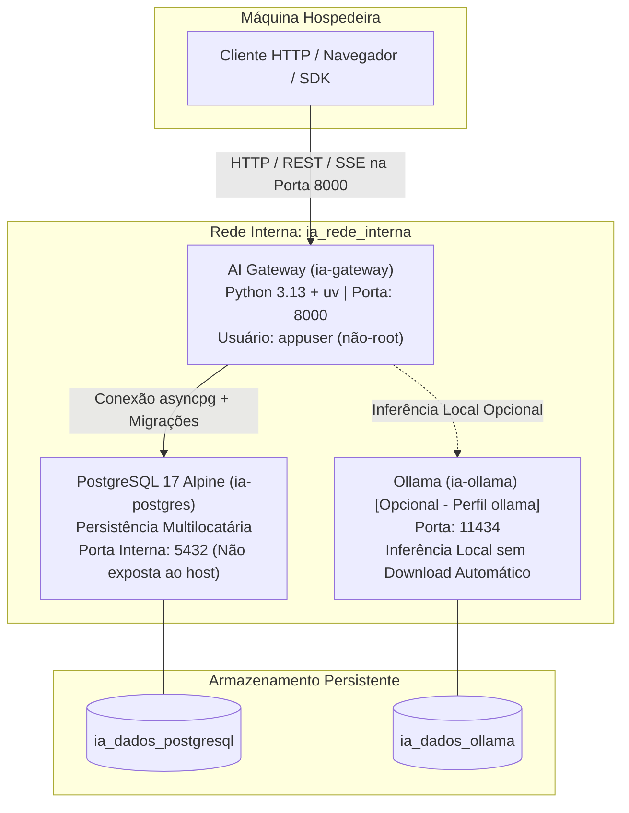

# Infraestrutura Local e Orquestração com Docker Compose

Este documento define a arquitetura de infraestrutura conteinerizada da plataforma **Reusable AI Backend Architecture**, detalhando a orquestração via Docker Compose, as políticas de segurança de contêineres e os procedimentos operacionais.

---

## 1. Visão Geral da Arquitetura de Contêineres

A infraestrutura foi projetada para garantir **reprodutibilidade estrita**, isolamento de rede corporativa e persistência íntegra entre reinicializações.



---

## 2. Serviços Orquestrados

### 2.1. `ai-gateway`
- **Imagem**: Construída a partir de `Dockerfile` multi-stage com `python:3.13-slim` e `uv`.
- **Segurança**:
  - Execução restrita sob usuário `appuser` (UID/GID `10001`), sem acesso root.
  - Imagem limpa sem compiladores ou ferramentas desnecessárias no runtime.
- **Porta Exposta**: `8000:8000` (configurável via `GATEWAY_PORTA`).
- **Prontidão (Healthcheck)**: Sonda HTTP interna a cada 10s via interpretador nativo Python no endpoint `/health`.
- **Dependência Declarativa**: Depende de `postgres` estar em estado saudável (`condition: service_healthy`).
- **Ciclo de Vida e Migrações**: Aplica automaticamente as migrações versionadas idempotentes no startup via lifespan assíncrono.

### 2.2. `postgres` (PostgreSQL 17)
- **Imagem Oficial**: `postgres:17-alpine`.
- **Isolamento de Borda**: **A porta 5432 NÃO é publicada externamente na máquina hospedeira por padrão**. Apenas contêineres conectados à rede `ia_rede_interna` possuem acesso.
  > [!TIP]
  > Para fins de depuração local com ferramentas como DBeaver ou psql, descomente a seção `ports: - "127.0.0.1:5432:5432"` no `docker-compose.yml`.
- **Volume Persistente**: Mapeado para o volume nomeado `ia_dados_postgresql`, garantindo a retenção completa de históricos, usuários e conversas após reinicializações.
- **Healthcheck**: Validação ativa de conectividade via utilitário `pg_isready`.

### 2.3. `ollama` (Serviço Opcional por Perfil)
- **Perfil do Compose**: `profiles: ["ollama"]`.
- **Comportamento**: Não é iniciado por padrão no comando básico `docker compose up`.
- **Gerenciamento de Modelos**: Não realiza download automático de pesos de modelos volumosos sem comando explícito do operador, prevenindo consumo inesperado de banda ou disco.
- **Volume Persistente**: Mapeado para `ia_dados_ollama`.

---

## 3. Gestão de Configurações e Variáveis de Ambiente

Antes de iniciar a infraestrutura, crie o arquivo de ambiente local copiando o modelo documentado:

```bash
cp .env.example .env
```

### Variáveis Principais

| Variável | Valor Padrão no Compose | Descrição |
| :--- | :--- | :--- |
| `GATEWAY_AMBIENTE` | `desenvolvimento` | Ambiente operacional (`desenvolvimento`, `teste`, `homologacao`, `producao`). |
| `GATEWAY_API_KEY` | `dev-local-master-key-12345678` | Chave mestre de autenticação da API. |
| `GATEWAY_CHAVES_CONFIAVEIS` | `dev-service-m2m-key-12345678` | Chaves para delegação M2M e representação de usuário. |
| `GATEWAY_MEMORIA_TIPO` | `postgresql` | Mecanismo de persistência (`memoria`, `sqlite`, `postgresql`). |
| `POSTGRES_DB` | `ia_conversas` | Nome do banco de dados relacional. |
| `POSTGRES_USER` | `usuario_ia` | Usuário do banco de dados. |
| `POSTGRES_PASSWORD` | `senha_ia_local` | Senha de desenvolvimento do banco. |
| `GATEWAY_POSTGRES_POOL_SIZE` | `10` | Tamanho máximo do pool assíncrono de conexões (`asyncpg`). |
| `OLLAMA_BASE_URL` | `http://ollama:11434` | Endpoint interno da inferência local Ollama. |

---

## 4. Procedimentos Operacionais

### 4.1. Inicialização Padrão (Gateway + PostgreSQL 17)
Inicializa os serviços centrais em segundo plano:
```bash
docker compose up -d
```

### 4.2. Inicialização com Inferência Local (Ollama)
Inicializa a infraestrutura completa incluindo o servidor Ollama:
```bash
docker compose --profile ollama up -d
```

### 4.3. Monitoramento e Inspeção de Saúde
Verificar o estado dos contêineres e os resultados dos healthchecks:
```bash
docker compose ps
```

Acompanhar os logs do AI Gateway em tempo real:
```bash
docker compose logs -f ai-gateway
```

Acompanhar os logs do PostgreSQL:
```bash
docker compose logs -f postgres
```

### 4.4. Execução Manual de Migrações (Opcional)
Embora o Gateway execute as migrações automaticamente no startup, é possível executá-las de forma explícita via CLI:
```bash
docker compose run --rm ai-gateway python -m ai_gateway.migrar
```

### 4.5. Encerramento Gracioso dos Serviços
Para parar os serviços preservando todos os dados gravados nos volumes:
```bash
docker compose down
```

Para interromper incluindo os contêineres do perfil Ollama:
```bash
docker compose --profile ollama down
```

> [!CAUTION]
> O comando `docker compose down -v` exclui os volumes de dados persistentes. Utilize-o exclusivamente quando desejar redefinir completamente o ambiente local de desenvolvimento.

---

## 5. Práticas de Segurança e Hardening em Contêineres

1. **Princípio do Menor Privilégio**: O contêiner do AI Gateway roda estritamente como usuário `appuser` (UID `10001`), impossibilitando escalonamento de privilégios para a raiz do hospedeiro.
2. **Rede Isolada**: A rede `ia_rede_interna` opera em modo bridge dedicado, mantendo o tráfego do banco restrito ao ecossistema de microsserviços.
3. **Fail-Closed em Produção**: Caso `GATEWAY_AMBIENTE=producao` seja configurado, o AI Gateway valida a entropia e autenticidade das chaves antes de abrir a porta HTTP, abortando imediatamente se credenciais fracas ou padrão forem identificadas.
