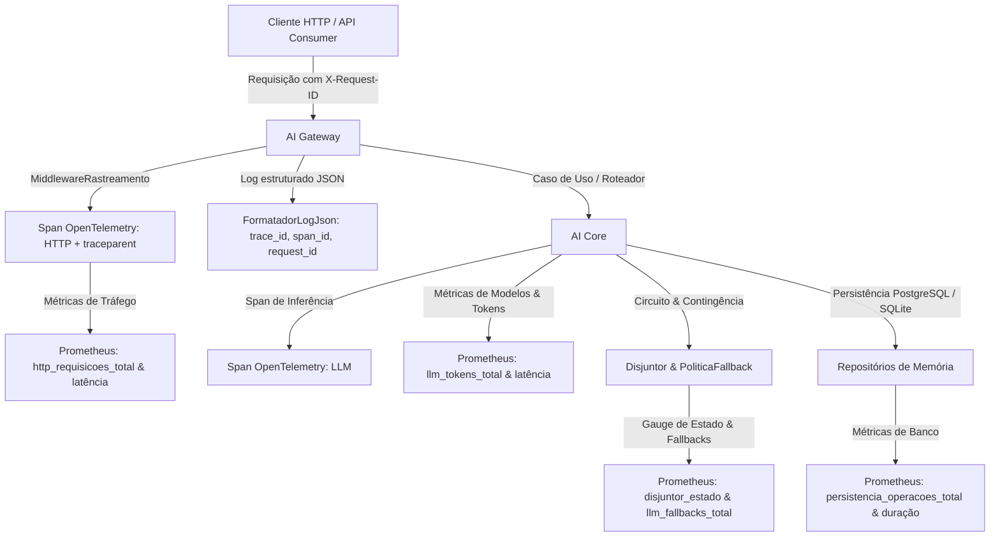

# Guia de Observabilidade, Métricas Prometheus e Rastreamento Distribuído

Este documento detalha os padrões, arquitetura e convenções da camada de observabilidade da **Reusable AI Backend Architecture**.

---

## 1. Visão Geral da Arquitetura de Observabilidade

A arquitetura adota uma abordagem unificada para os três pilares da observabilidade corporativa:



---

## 2. Métricas Prometheus

As métricas são expostas no endpoint padrão `GET /metrics` no formato oficial texto (versão 0.0.4) do Prometheus.

### 2.1 Catálogo de Métricas

| Métrica | Tipo | Labels | Descrição |
| :--- | :--- | :--- | :--- |
| `http_requisicoes_total` | Contador | `metodo`, `rota`, `status_codigo` | Volume total de requisições HTTP recebidas |
| `http_requisicao_duracao_segundos` | Histograma | `metodo`, `rota` | Latência das requisições HTTP (buckets de 5ms a 10s) |
| `llm_execucao_duracao_segundos` | Histograma | `modelo`, `provedor` | Duração temporal das inferências de IA (buckets de 100ms a 60s) |
| `llm_tokens_total` | Contador | `modelo`, `tipo` (`entrada`, `saida`) | Volume faturado de tokens consumidos por modelo |
| `llm_falhas_total` | Contador | `modelo`, `tipo_erro` | Contagem de erros de inferência (timeout, taxa, conexão) |
| `llm_fallbacks_total` | Contador | `modelo_origem`, `modelo_destino` | Acionamentos de políticas de contingência |
| `agente_passos_total` | Contador | `modelo` | Passos cognitivos executados no ciclo ReAct |
| `agente_erros_total` | Contador | `modelo` | Falhas ou exceções no ciclo de execução do agente |
| `disjuntor_estado` | Gauge | `disjuntor` | Estado atual do circuito: `0` (Fechado), `1` (Meio-Aberto), `2` (Aberto) |
| `persistencia_operacoes_total` | Contador | `tipo_memoria`, `operacao`, `sucesso` | Operações realizadas nos bancos SQLite e PostgreSQL |
| `persistencia_duracao_segundos` | Histograma | `tipo_memoria`, `operacao` | Tempo de resposta de leitura e escrita de histórico conversacional |

### 2.2 Política de Baixa Cardinalidade

Para evitar exaustão de memória em sistemas de time-series (Prometheus/Thanos/Cortex):
- **Proibido** utilizar identificadores de usuário (`id_usuario`), IDs de conversa (`id_conversa`) ou valores de parâmetros em labels.
- O campo `rota` utiliza templates padronizados (ex: `/v1/chat/conclusoes`), normalizados automaticamente pelo `MiddlewareRastreamento`.

---

## 3. Rastreamento Distribuído (OpenTelemetry)

A plataforma integra nativamente o **OpenTelemetry Python SDK** com os seguintes recursos:

### 3.1 Propagação de Contexto e Cabeçalhos
- Todo ciclo HTTP gera ou propaga um `trace_id` de 32 caracteres hexadecimais e um `span_id` de 16 caracteres hexadecimais.
- A resposta HTTP devolve o cabeçalho padrão **W3C `traceparent`** (ex: `00-4bf92f3577b34da6a3ce929d0e0e4736-00f067aa0ba902b7-01`).
- Também são mantidos os cabeçalhos operacionais `X-Request-ID` e `X-Process-Time`.

### 3.2 Spans Sanitizados e Proteção de Dados Sensíveis
O `GerenciadorRastreamento` garante por projeto que:
- Prompts de usuários, conteúdos de respostas, mensagens conversacionais, chaves de API e senhas **nunca** são inseridos como atributos de spans.
- Atributos permitidos incluem apenas metadados técnicos de infraestrutura e contadores (`modelo`, `status_code`, `http.method`, `total_tokens`).

### 3.3 Resiliência e Fallback Local
- Quando nenhuma URL de coletor OTLP externo for informada (`OTEL_ENDPOINT_OTLP`), o tracing opera com o `ExportadorSpansMemoria` sem bloquear o processamento nem gerar erros de rede.
- Caso um endpoint OTLP falhe durante a inicialização, a plataforma chaveia automaticamente para o buffer em memória.

### 3.4 Limitações da Exportação OTLP e Integrações Futuras
- **Protocolo de Transporte**: A biblioteca adota nativamente o exportador HTTP com protocolo Protobuf (`opentelemetry-exporter-otlp-proto-http`), compatível com endpoints padrão `/v1/traces` (porta padrão `4318`). Não requer suporte a gRPC (`4317`), simplificando roteamentos por proxies reversos HTTP e firewalls.
- **Isolamento de Erros e Backpressure**: O `BatchSpanProcessor` opera de maneira desacoplada em threads secundárias de envio em lote. Se o coletor remoto sofrer lentidão ou indisponibilidade, os spans pendentes expiram ou são descartados graciosamente conforme a fila máxima configurada, preservando a estabilidade e a latência das respostas ao usuário final.
- **Configuração para Coletor Centralizado**: Para enviar traces a um backend como Jaeger, Grafana Tempo, SigNoz ou AWS X-Ray, basta configurar:
  ```env
  OTEL_HABILITADO=true
  OTEL_ENDPOINT_OTLP=http://otel-collector:4318/v1/traces
  OTEL_NOME_SERVICO=ai-gateway
  ```
  Nenhuma alteração de código é necessária. Em ambientes locais ou sem coletor, a ausência de `OTEL_ENDPOINT_OTLP` faz a aplicação utilizar o armazenamento em memória `ExportadorSpansMemoria`, permitindo inspeção em testes automatizados.

---

## 4. Logs Estruturados em JSON

O formatador corporativo `FormatadorLogJson` emite cada linha de log como um objeto JSON estruturado:

```json
{
  "timestamp": "2026-10-28T04:45:00.123456+00:00",
  "servico": "ai-gateway",
  "nivel": "INFO",
  "logger": "ai_gateway.acesso",
  "mensagem": "Requisição HTTP concluída com sucesso.",
  "arquivo": "rastreamento.py",
  "linha": 72,
  "trace_id": "4bf92f3577b34da6a3ce929d0e0e4736",
  "span_id": "00f067aa0ba902b7",
  "request_id": "c1f729b4-5412-42bb-954f-1249aa98e541"
}
```

### 4.1 Mascaramento Automático de Credenciais
Antes da emissão do JSON, qualquer padrão correspondente a tokens Bearer, chaves OpenAI (`sk-...`) ou chaves Google (`AIza...`) presentes na mensagem é mascarado automaticamente por `[CREDENTIAL_REDACTED]`.

---

## 5. Configuração e Segurança do Endpoint `/metrics`

As seguintes variáveis de ambiente controlam o comportamento:

| Variável | Padrão | Descrição |
| :--- | :--- | :--- |
| `METRICAS_HABILITADAS` | `true` | Habilita ou desabilita o endpoint `/metrics` (retorna 404 se falso) |
| `METRICAS_TOKEN` | `None` | Token de segurança exigido para scraping. Se definido, exige `Authorization: Bearer <token>` |
| `OTEL_HABILITADO` | `true` | Ativa ou desativa a geração de spans OpenTelemetry |
| `OTEL_ENDPOINT_OTLP` | `None` | Endpoint HTTP OTLP do coletor (ex: `http://otel-collector:4318/v1/traces`) |
| `OTEL_NOME_SERVICO` | `ai-gateway` | Nome do serviço reportado na telemetria |

### Exemplo de Configuração de Coleta no Prometheus (`prometheus.yml`)

```yaml
scrape_configs:
  - job_name: 'ai-gateway'
    scrape_interval: 10s
    metrics_path: '/metrics'
    bearer_token: '${METRICAS_TOKEN}' # Caso token de scraping esteja configurado
    static_configs:
      - targets: ['ia-gateway:8000']
```
